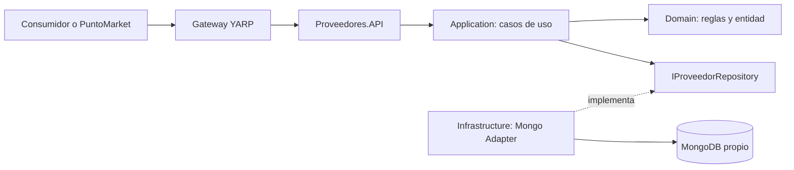

> Integración actual: el entorno común utiliza el Compose raíz, Gateway/, Frontend/ y Keycloak. Los comandos y componentes demo descritos aquí pertenecen exclusivamente a `docker-compose.demo.yml`. Los resultados de auditorías anteriores son históricos; véase el README y los acuerdos Grupo 2 para el estado integrado.

# Guía de integración — Grupo 1: Proveedores

Grupo 1 es responsable de Proveedores en Servicio4.Proveedores. Esta guía detalla su contrato y el entorno demo; el entorno común integrado utiliza Gateway/, Frontend/ y Keycloak. Consultar [acuerdos Grupo 2](INTEGRACION_GRUPO2.md) para la separación actual.

## 1. Diagnóstico de Servicio1 y Servicio4

La ubicación definitiva en `micro-proveedor` es **Servicio4.Proveedores/**. Contiene los cinco proyectos .NET 10, solución propia, Dockerfile, configuración y pruebas. La solución raíz y Compose apuntan a esa carpeta. Los nombres de proyectos y namespaces `Proveedores.*` permanecen iguales.

Antes de esta reorganización, `Servicio1.Proveedores` contenía la implementación funcional y Servicio4 solo tenía 25 archivos generados de NuGet en obj. Se verificó el destino antes de retirar esa caché, se trasladaron todos los archivos del origen y se comprobaron sus huellas SHA-256 antes de eliminar la carpeta vacía. Esta mención de Servicio1 es histórica, no una ruta ejecutable.

El traslado conservó la implementación propia y los cambios documentales. El merge posterior incorpora Gateway, Frontend, Keycloak y los demás servicios comunes. Se conciliaron Docker y documentación; se conserva MetadataAddress opcional, la referencia de pruebas a DevIdentity y DockerIdentityTests.cs. El frontend común todavía no incorpora las pantallas de Proveedores.

Domain no tiene referencias externas; Application referencia Domain y abstracciones DI; Infrastructure referencia Application y MongoDB.Driver; API compone Application/Infrastructure, JWT y Swagger; Tests referencia API, Frontend.Demo y DevIdentity.Demo con los alias existentes.

## 2. Arquitectura y patrones



El controlador autoriza y traduce Result a HTTP; Application coordina repositorio, usuario y reloj; Domain valida y gestiona estado/auditoría; Infrastructure convierte BSON, mantiene índices y escribe atómicamente. API compone las dependencias. El servicio no requiere Usuarios ni Productos para operar y no consulta bases ajenas.

| Patrón | Implementación y defensa |
|---|---|
| Result | Domain/Common/Result.cs: éxito/fallo esperado con Error (código, mensaje, tipo y campos opcionales). Las validaciones no son excepciones. API/Http/ResultHttpMapper.cs traduce a HTTP. |
| Adapter | IProveedorRepository es el puerto; MongoProveedorRepository adapta MongoDB. ProductoApiAdapter adapta HTTP de Productos, aún sin invocarse en el CRUD. Repository es el rol, Adapter la técnica y DI entrega la implementación. |
| Factory Method | ProveedorCreator.Crear valida y delega en InstanciarProveedor; creadores estándar/autogestionado y selector por modalidad. Nuevas modalidades también requieren revisar el selector. Rehidratar es distinto de crear un proveedor nuevo. |
| Singleton | Infrastructure/DependencyInjection.cs registra MongoClient por DI: una instancia por proceso y pool reutilizado, no una instancia global entre contenedores. |

SOLID: responsabilidades separadas, puertos pequeños, dependencia de abstracciones y creadores sustituibles. Integrar otros CRUD no exige invertir las referencias de estas capas.

## 3. Endpoints reales

Demo local sin Docker: Gateway http://localhost:5000 y API http://localhost:5200. Demo Docker: Gateway 15000 y API 15200 por defecto. Entorno común: Gateway 5000 y API 5005 por defecto. Ajustar según variables de entorno. Estos paths pertenecen exclusivamente a Proveedores.

| Método | Path | Permiso | Éxito |
|---|---|---|---|
| GET | /api/proveedores | Administrador o Cajero | 200, página |
| GET | /api/proveedores/{id} | Administrador o Cajero | 200, proveedor |
| POST | /api/proveedores | Administrador | 201, proveedor y Location |
| PUT | /api/proveedores/{id} | Administrador | 200, proveedor |
| DELETE | /api/proveedores/{id} | Administrador | 204, baja lógica |
| PATCH | /api/proveedores/{id}/reactivar | Administrador | 200, proveedor |
| GET | /health | Anónimo, API directa | 200 si el host responde |

Fuente: [ProveedoresController](Servicio4.Proveedores/Proveedores.API/Controllers/ProveedoresController.cs). El Gateway de esta rama no expone salud agregada de Proveedores: su /health comprueba el proxy, no MongoDB.

| Parámetro del listado | Valores y límites |
|---|---|
| busqueda | Opcional, trim; blanco equivale a sin filtro; máximo 150, sin controles/invisibles peligrosos |
| estado | Todos (predeterminado), Activos, Inactivos |
| ordenarPor | Nombre (predeterminado), Numero, FechaCreacion, FechaActualizacion |
| descendente | false por defecto |
| pagina | 1 por defecto; normalizada para evitar overflow del desplazamiento |
| tamanoPagina | 10 por defecto, normalizado entre 1 y 100 |

Mongo ordena antes de paginar y desempata por _id ascendente. Con búsqueda prioriza prefijo del nombre normalizado, parcial de nombre y teléfono/correo; el orden elegido se aplica dentro de cada prioridad. Regex.Escape trata especiales como datos. La UI ofrece solo Nombre A-Z/Z-A y Activos por defecto; no cambia el contrato API.

## 4. Contratos JSON

POST y PUT usan el mismo cuerpo; PUT no es parcial. PATCH de reactivación y DELETE no requieren cuerpo.

```json
{
  "nombreEmpresa": "Comercial Ejemplo",
  "numeroEmpresa": "71234567",
  "correoReferencia": "ventas@empresa.com",
  "esAutogestionado": false
}
```

No enviar id, estado, auditoría, origenSeed, nombreNormalizado ni version. esAutogestionado es bool; si se omite toma false, no se deduce de la procedencia del registro.

Salida individual con valores exclusivamente ilustrativos:

```json
{
  "id": "507f1f77bcf86cd799439011",
  "nombreEmpresa": "Comercial Ejemplo",
  "numeroEmpresa": "71234567",
  "correoReferencia": "ventas@empresa.com",
  "esAutogestionado": false,
  "estaActivo": true,
  "idUsuarioAdmin": "identidad-de-ejemplo",
  "idUsuarioActualizacion": null,
  "fechaCreacion": "2026-01-01T12:00:00Z",
  "fechaActualizacion": null
}
```

Listado:

```json
{"items":[],"pagina":1,"tamanoPagina":10,"total":0,"totalPaginas":0}
```

El ID es string hexadecimal ObjectId; no convertirlo a entero ni confundirlo con sub del usuario. total es Int64; totalPaginas se satura a Int32.MaxValue. Los campos opcionales pueden ser null.

Fuentes: [GuardarProveedorRequest](Servicio4.Proveedores/Proveedores.Application/Dtos/GuardarProveedorRequest.cs), [ProveedorDto](Servicio4.Proveedores/Proveedores.Application/Dtos/ProveedorDto.cs) y [PaginaResultado](Servicio4.Proveedores/Proveedores.Application/Dtos/PaginaResultado.cs).

## 5. Validaciones, estado y errores

| Regla | Implementación |
|---|---|
| Nombre | Obligatorio, máximo 150 tras limpieza; trim y espacios colapsados preservan ortografía, mayúsculas y tildes visibles. Permite letras/números Unicode y puntuación comercial; rechaza solo símbolos, marcado, código evidente, controles e invisibles peligrosos. |
| Nombre equivalente | Ignora mayúsculas, tildes y espacios; unicidad entre activos mediante Application e índice único parcial. |
| Teléfono | String obligatorio, 8 dígitos ASCII con inicio 4/6/7, sin +591 ni 591; trim exterior, sin símbolos ni espacios interiores. Máximo estructural 20. Política específica del proyecto, no toda la numeración boliviana. |
| Correo | Opcional, blanco -> null, máximo 150; una arroba, local ASCII no entrecomillado hasta 64, dominio ASCII con punto y etiquetas válidas; admite + y subdominios. No verifica buzón/DNS ni unicidad y no cubre todas las variantes RFC/internacionalizadas. |
| Modalidad | esAutogestionado indica quién gestiona la reposición; no concede permisos ni cambia validaciones CRUD. |
| Estado | No hay borrado físico; no editar inactivos ni reactivar con un nombre tomado por otro activo. |
| Entradas y salida | Razor codifica; mensajes JS usan textContent; filtros Mongo tipados, búsqueda escapada y ObjectId.TryParse. Objetos/operadores no sustituyen strings comerciales. |

Domain/Entities/ProveedorValidador.cs es la autoridad. Frontend anticipa errores, conserva valores y reabre el modal al fallar.

| HTTP | Significado |
|---|---|
| 400 | Validación, JSON incompatible o parámetros malformados |
| 401 | Token ausente/inválido/vencido o identidad sin identificador requerido |
| 403 | Usuario autenticado sin permiso |
| 404 | Proveedor inexistente o ID malformado |
| 409 | Nombre duplicado, estado incompatible o cambio concurrente |
| 503 | Fallo técnico/integración no disponible cuando corresponde |
| 500 | Fallo inesperado con mensaje controlado |

ProblemDetails de negocio contiene status, title, detail y code. Validación comercial añade errors opcional por nombreEmpresa/numeroEmpresa/correoReferencia. JSON/tipos malformados reciben Solicitud.Invalida. No asumir que los 401/403 del middleware incluyen ese mismo JSON.

```json
{"status":400,"title":"Datos inválidos","detail":"El número de la empresa es obligatorio.","code":"Proveedor.NumeroRequerido","errors":{"numeroEmpresa":["El número de la empresa es obligatorio."]}}
```

## 6. Persistencia, seed, auditoría y concurrencia

Local: Mongo:ConnectionString, DatabaseName=proveedores_db, ProveedoresCollection=proveedores. En Docker se usa mongodb://mongodb:27017 y volumen propio; Compass del host usa 27028 por defecto en la demo (o MONGO_PORT). No compartir base ni credenciales con otros servicios.

Campos persistidos: _id, nombreEmpresa, nombreNormalizado, numeroEmpresa, correoReferencia, esAutogestionado, estaActivo, idUsuarioAdmin, idUsuarioActualizacion, fechaCreacion, fechaActualizacion y version. origenSeed es metadato opcional de infraestructura. DTOs no exponen version, origenSeed ni nombreNormalizado.

ux_proveedores_nombre_activo es único sobre nombreNormalizado con filtro estaActivo=true. El índice sparse de origenSeed no es único: el seed normal usa su marca y $setOnInsert, con protección adicional de nombres activos.

El seed valida e inserta PIL, EMBOL, Sofía, CBN, Unilever, Industrias Venado y Arcor. En una base vacía basta iniciar API: no importar SQL ni la base personal. No sobrescribe registros ya sembrados ni repite la actualización administrativa histórica. Mongo__SeedEnabled=false desactiva seed; Mongo__InitializeOnStartup=false desactiva todo el inicializador de índices/seed.

idUsuarioAdmin significa creador, no propietario ni permiso. Proviene del claim configurado mediante ICurrentUser; seed utiliza un actor de sistema. Fechas UTC; editar/desactivar/reactivar registra último usuario y fecha. No resolver una FK consultando la base de Usuarios.

version comienza en 0 y ausencia antigua equivale a 0. El repositorio filtra por _id/versión y escribe $set más $inc atómicamente. Un 409 exige recargar. No protege un formulario viejo enviado después de una modificación completada, porque no se intercambia versión con el cliente.

origenSeed se conserva porque no se reemplaza todo el documento. No pasar a ReplaceOne sin revisar metadatos. Rehidratar no revalida datos históricos: una edición puede rechazar datos que siguen consultándose. Tipos BSON incompatibles o campos desconocidos pueden fallar; no hay tolerancia universal ni migración automática. Un nombreNormalizado incorrecto requiere auditoría, no reparación silenciosa.

## 7. JWT y compatibilidad con Keycloak

Aquí Proveedores valida firma/JWKS, issuer, audience y vigencia; el Gateway demo solo propaga Authorization. DevIdentity emite RS256, aud=proveedores-api y dos identidades fijas. Frontend guarda perfil en sesión y JWT en caché por perfil; no es login personal real.

Opciones Authentication:Jwt: Authority, MetadataAddress opcional, Audience, RequireHttpsMetadata, UserIdClaim (sub), RoleClaimPaths y RoleMapping. En Docker Authority es público y MetadataAddress descubre por identity-dev:8080. JWKS usa el origen de consulta; el issuer firmado sigue siendo el configurado.

Compatibilidad con Keycloak significa configuración JWT y mapeo de roles, **no integración activa aquí**. El token debe incluir proveedores-api en aud y un rol permitido. Conservar ValidateIssuer/ValidateAudience/ValidateLifetime/ValidateIssuerSigningKey. No aceptar un token de Usuarios solo por tener username; acordar emisor, audiencias y claims. Ver [estado Grupo 2](INTEGRACION_GRUPO2.md).

## 8. Consumo desde otros grupos

1. Usar este contrato y OpenAPI de /swagger en la API Development.
2. Enviar Bearer al Gateway y application/json en escrituras; nunca acceder a la colección.
3. Conservar el ID string y tratar auditoría/estado como salida del servidor.
4. Respetar HTTP/code, límites y cancelación; ante 409 recargar, sin reintentos ciegos de escrituras.
5. No introducir dependencia de Proveedores hacia Usuarios para habilitar el CRUD.
6. Para otro servicio usar su adaptador HTTP; para UI, páginas/cliente propios y layout común.

YARP actual: ApiGateway/ApiGateway.Demo/appsettings.json, clusters proveedores-cluster y dev-identity-cluster. Compose cambia destinos a proveedores-api:8080 e identity-dev:8080. No alterar paths públicos ni introducir otro catch-all que los capture.

El cliente nombrado del frontend usa ApiGateway:BaseUrl. ProveedoresApiClient.cs es referencia de transporte, no DTOs genéricos. La navegación está en Pages/Shared/_Layout.cshtml; Inicio equivale actualmente a «no Proveedores» y debe revisarse al añadir módulos. El JS de búsqueda pertenece a Proveedores.

## 9. Dependencias y ejecución

SDK .NET 10, MongoDB para persistencia y Node.js para pruebas JS. Gateway usa YARP 2.3.0; Infrastructure MongoDB.Driver 3.13.0; API JwtBearer 10.0.0 y Swagger. Versiones exactas en csproj y Directory.Build.props; no añadir paquetes a Domain.

[Arranque principal](README.md), [Docker](GUIA_DOCKER_PUNTOMARKET.md), [API](Servicio4.Proveedores/README.md) y [frontend](Frontend/Frontend.Demo/README.md).

```powershell
dotnet restore Proyecto_Microservicios.slnx
dotnet build Proyecto_Microservicios.slnx --no-restore
dotnet test Servicio4.Proveedores/Proveedores.slnx
node scripts/probar-validaciones-frontend.cjs
node scripts/probar-busqueda-dinamica.mjs
```

Sin PROVEEDORES_TEST_MONGO se omiten pruebas Mongo. Para integración usar un servidor de pruebas y dejar que cada prueba cree su base temporal. No probar escrituras sobre datos personales. verificar-docker.ps1 exige autorización, añade evidencia y puede recrear la pila: no es una comprobación documental de solo lectura.

## 10. Pendientes y límites conservados

- No desactivar con productos activos: pendiente de usar IProductoApiClient por HTTP en DesactivarProveedor. El adaptador exige cantidad entera presente/no negativa; no asumir cero si falla. La ruta de Productos todavía debe acordarse.
- Login real y Keycloak existen en el entorno común. La demo continúa usando DevIdentity; Grupo 2 debe integrar sus pantallas de Proveedores con la sesión común antes de retirar consumidores temporales.
- Unificar Servicio1/Servicio4 y elegir Gateway/Frontend comunes exige otra tarea y regresión.
- Búsqueda de subcadenas/prioridad puede recorrer documentos; Count y listado no son una instantánea transaccional.
- Sesión demo en memoria; Logout no revoca tokens compartidos; DevIdentity cambia RSA al reiniciar.
- Sin historial completo de auditoría ni control por ETag/formulario: solo creador, última modificación y versión interna.

## 11. Mantenimiento del Grupo 1

Se conserva aquí la información operativa de la antigua guía de agentes:

1. Leer README e INTEGRACION_GRUPO2 y comprobar la rama antes de integrar.
2. Domain puro; Application depende de Domain; Infrastructure implementa puertos; API compone.
3. No añadir MongoDB, ASP.NET, HTTP ni paquetes externos a Domain.
4. Conservar Result y los cuatro patrones; excepciones para fallos técnicos.
5. Bases independientes; integración mediante HTTP/adaptadores.
6. Componentes demo solo en desarrollo, sin presentarlos como identidad de producción.
7. Documentar/acordar cambios de rutas, DTOs, HTTP, claims, variables o configuración con consumidores.
8. Tras cambios funcionales ejecutar dotnet test Servicio4.Proveedores/Proveedores.slnx y comprobaciones pertinentes; informar resultados y omisiones reales.
9. Proveedores debe funcionar sin Productos u otros CRUD. No borrar datos, índices, volúmenes o carpetas como limpieza documental.

Los informes históricos retirados contenían planes ya aplicados y evidencias locales. Las reglas, decisiones, patrones, pendientes y límites relevantes quedan consolidados aquí. No repetir actualizaciones SQL/Mongo ni publicar copias BSON, IDs reales o registros manuales para consumir el servicio.

### Verificación histórica de la limpieza documental anterior

Se comprobaron enlaces locales, ausencia de referencias obsoletas en documentación/comentarios, hashes de fuentes/configuraciones y conservación de ambas carpetas. El único cambio fuera de Markdown actualiza el nombre de esta guía en un comentario del Gateway, sin cambio ejecutable. Rama/HEAD permanecieron micro-proveedor/77c46f2; no hubo commit, push, pull, merge, fetch ni cambio de rama.

Se ejecutó la suite: 201 aprobadas, 0 fallidas y 14 Mongo omitidas deliberadamente con PROVEEDORES_TEST_MONGO vacío, sin acceder a bases de datos. Pasaron también los 60 casos JS de formulario y las pruebas del buscador. No se reejecutó el ciclo de vida Docker ni se atribuyen estos resultados a otras ramas.

### Verificación de la reorganización a Servicio4

Se trasladaron 672 archivos, incluidos generados; los 80 archivos no generados se conservaron. Se comprobaron huellas SHA-256 antes de retirar la carpeta vacía de origen. Solo se ajustaron el comentario del Dockerfile y el README dentro del microservicio; código, proyectos, namespaces y contratos permanecen iguales. Se actualizaron solución raíz, contexto Compose, referencias documentales y tres scripts locales de datos (sin ejecutarlos).

Restore y build de la solución completa terminaron correctamente, con cero advertencias y errores. La suite ejecutada desde Servicio4 aprobó 215 pruebas, sin fallos ni omisiones, usando MongoDB local y bases temporales aisladas. Las comprobaciones JavaScript, Compose y construcción Docker de proveedores-api también terminaron correctamente. Los contenedores existentes no se recrearon ni se actualizaron sus datos. Git reconoció los 80 traslados mediante un índice temporal, sin alterar el staging real ni crear commits.
