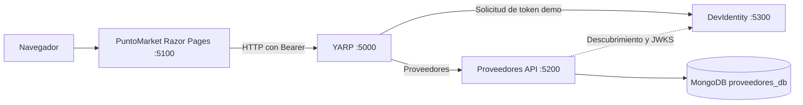
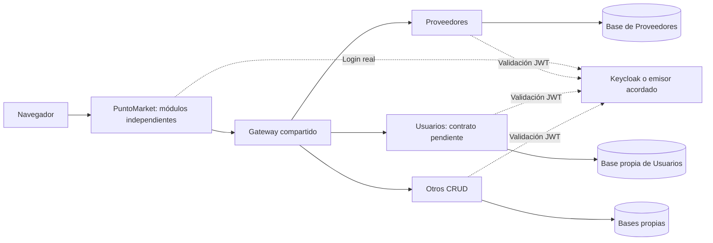

# Integración común actual

El entorno principal es `docker-compose.yml`, con Gateway/, Frontend/, Keycloak y los cuatro servicios con bases independientes. La solución raíz incluye los 25 proyectos, incluidas todas las pruebas disponibles. La demo se ejecuta solo con `docker-compose.demo.yml`; no es el frontend definitivo.

Consultar [README](README.md) para comandos actuales, [acuerdos Grupo 2](INTEGRACION_GRUPO2.md) para JWT/sesión y [Grupo 1](GUIA_INTEGRACION_GRUPO1.md) para el contrato de Proveedores. El frontend común aún no contiene /Proveedores; Grupo 2 debe integrar ese módulo con su sesión y adaptadores HTTP. No arrancar pilas sobre los mismos puertos ni compartir volúmenes automáticamente.

## Guía previa conservada como referencia histórica

Los apartados siguientes se conservan para no perder el análisis, contratos y puntos de extensión aportados por main. Las afirmaciones de que Usuarios/Keycloak no existen, Docker está pendiente o el Gateway no valida JWT corresponden a la demo anterior, **no al entorno común actual**. Los resultados de pruebas citados son históricos. No ejecutar comandos Compose de estos apartados sobre el archivo raíz para probar la demo: utilizar siempre `-f docker-compose.demo.yml`.

# Guía de integración de microservicios — PuntoMarket

Los artefactos y evidencias locales citados en esta guía no se versionan ni contienen datos necesarios para clonar o ejecutar el proyecto. Docker queda fuera de esta publicación inicial.

Esta guía describe el código actual y los cambios futuros que deberán acordarse entre grupos. La documentación añadida no registra servicios, modifica contratos ni activa integraciones. Usuarios todavía no tiene un contrato disponible en esta solución: no se presentan rutas ficticias como si existieran.

## 1. Arquitectura actual y objetivo



El navegador usa la sesión de Razor. El servidor del frontend obtiene el JWT y llama al Gateway; no guarda ese token en localStorage. El Gateway enruta y cada microservicio valida su propia seguridad.

Objetivo, pendiente de contratos e identidad compartidos:



Se pueden integrar servicios de otras tecnologías y repositorios. No necesitan referenciar los proyectos de Proveedores ni formar parte del archivo de solución para comunicarse por HTTP.

## 2. Función de cada proyecto

| Proyecto o carpeta | Responsabilidad | Estado |
|---|---|---|
| Servicio4.Proveedores/Proveedores.Domain | Entidad, reglas, normalización, Factory Method y Result; sin MongoDB/HTTP | Definitivo |
| Servicio4.Proveedores/Proveedores.Application | Casos de uso, DTOs y puertos de repositorio/usuario actual | Definitivo |
| Servicio4.Proveedores/Proveedores.Infrastructure | MongoDB, documentos BSON, índices, seed y adaptadores | Definitivo |
| Servicio4.Proveedores/Proveedores.API | Endpoints, JWT, roles, traducción HTTP y composición DI | Definitivo |
| Servicio4.Proveedores/Proveedores.Tests | Pruebas de dominio, aplicación, API, frontend y MongoDB temporal | Verificación |
| ApiGateway/ApiGateway.Demo | Proxy YARP con rutas/destinos por configuración | Gateway temporal reutilizable |
| Frontend/Frontend.Demo | UI Razor PuntoMarket, sesión demo y clientes del Gateway | Frontend de demostración reutilizable |
| DevIdentity/DevIdentity.Demo | Emisor JWT local, dos identidades fijas y claves RSA en memoria | Solo demostración/Development |

Proveedores debe continuar funcionando sin Usuarios ni Productos. El adaptador de Productos está preparado, pero la regla de impedir bajas con productos activos sigue pendiente; no está activada.

## 3. Cómo funciona el Gateway

Revisar `ApiGateway/ApiGateway.Demo/Program.cs` y `appsettings.json`. Program carga la sección `ReverseProxy`; no contiene reglas comerciales.

| Ruta existente | Cluster | Destino configurado |
|---|---|---|
| /api/proveedores | proveedores-cluster | http://localhost:5200/ |
| /api/proveedores/{**catch-all} | proveedores-cluster | http://localhost:5200/ |
| /dev-auth/{**catch-all} | dev-identity-cluster | http://localhost:5300/ |

La ruta dev-auth elimina ese prefijo antes de reenviar: `/dev-auth/token` llega como `/token`. Proveedores conserva su ruta original. La ruta raíz y catch-all tienen cobertura parcialmente solapada, pero comparten destino; no se deben redirigir a servicios diferentes.

El Gateway actual propaga Authorization, pero no valida JWT, permisos, DTOs o reglas de negocio. El 401/403 de Proveedores procede de su API. Si se añade autorización al Gateway en el futuro, cada API debe conservar su validación.

`/health` corresponde al propio Gateway. No comprueba sus clusters, MongoDB ni otros servicios; tampoco están configuradas comprobaciones activas de salud de destinos.

## 4. Registrar un nuevo servicio en YARP

Realizar estos pasos únicamente tras recibir el contrato real y autorizar cambios funcionales:

1. Confirmar URL accesible, puerto, rutas internas y métodos del servicio.
2. Añadir una clave propia en `ReverseProxy:Clusters` con sus `Destinations` y `Address`.
3. Añadir las rutas necesarias en `ReverseProxy:Routes`. Su `ClusterId` debe coincidir exactamente con la clave del cluster.
4. Definir `Match.Path` con el prefijo público acordado. Revisar raíz, barra final y subrutas según el contrato.
5. Añadir transformaciones solo cuando el servicio espere un path diferente al público.
6. Comprobar que ninguna ruta nueva capture `/api/proveedores`, `/dev-auth` o `/health` de manera indebida.
7. Verificar el servicio directamente y luego mediante el Gateway; mantener los códigos HTTP y Authorization.

No se necesita cambiar Program para un enrutamiento normal. Los destinos de un mismo cluster deben ser instancias equivalentes del mismo servicio, no APIs distintas de Usuarios y Proveedores.

Las direcciones se pueden sobrescribir por entorno. Claves actuales de referencia:

```text
ReverseProxy__Clusters__proveedores-cluster__Destinations__proveedores-api__Address
ReverseProxy__Clusters__dev-identity-cluster__Destinations__dev-identity__Address
ApiGateway__BaseUrl
```

Los identificadores de las claves del servicio nuevo se elegirán al integrarlo. No añadir comentarios `//` a archivos JSON; usar los comentarios de Program y esta guía. No introducir una ruta global para resolver un prefijo desconocido.

## 5. Añadir un módulo Razor

Crear las páginas del nuevo módulo bajo `Frontend/Frontend.Demo/Pages/<Modulo>/`. Para el módulo de Usuarios se propone una carpeta `Pages/Usuarios/`, pero aún no se crean páginas ni se presupone la forma de su CRUD.

Revisar `Pages/Shared/_Layout.cshtml`: contiene menú, recursos CSS/JS comunes, perfil y pie de página. Añadir el enlace cuando exista la página y adaptar la condición de enlace activo: actualmente Inicio se selecciona cuando la página no es Proveedores. Esa condición no basta para tres módulos.

Reutilizar Bootstrap, iconos, tipografía y clases de `wwwroot/css/site.css`. Mantener la navbar, responsive, tarjetas y modales actuales. No copiar toda la página de Proveedores ni modificar sus handlers para atender otros CRUD.

Partes comunes: layout, recursos visuales, cliente nombrado ApiGateway y mecanismo de identidad acordado. Partes de Proveedores: modelos comerciales, ProveedoresApiClient, Pages/Proveedores y su módulo `proveedores-busqueda.mjs`. El panel inicial también contiene estadísticas específicas de Proveedores; ampliarlo es opcional, no un requisito para añadir navegación.

La UI puede ocultar acciones según permisos, pero eso no sustituye la autorización de la API. No asumir que Cajero puede consultar datos personales de Usuarios: solicitar su matriz de acceso.

## 6. Cliente HTTP de cada módulo

`Frontend/Frontend.Demo/Program.cs` registra el cliente nombrado `ApiGateway`, con BaseUrl configurable y timeout de 15 segundos. Cada cliente de módulo debe usar `IHttpClientFactory.CreateClient("ApiGateway")` y rutas relativas del contrato acordado; no direcciones internas ni conexiones de base de datos.

Usar `Services/ProveedoresApiClient.cs` como referencia de:

- Encabezado Bearer añadido por solicitud en el servidor.
- Serialización JSON y escape de parámetros.
- CancellationToken y manejo de timeout/red.
- Traducción de errores y conservación de HTTP 400/401/403/404/409.

Su método EnviarAsync es privado y sus DTOs/mensajes son específicos; no es un cliente genérico para todos los servicios. Crear un cliente y modelos de Usuarios cuando se conozcan sus contratos, registrarlo por DI y consumirlo desde sus PageModels. No copiar automáticamente el esquema de paginación o los mensajes de permisos de Proveedores.

Las llamadas API actuales son servidor a servidor; no es necesario añadir CORS solo por incorporar otro módulo Razor. Si se cambia a llamadas directas desde otro origen del navegador, habrá que revisar ese escenario por separado.

## 7. Transmitir y validar JWT

Circuito actual: Login selecciona un perfil, DemoTokenProvider llama a `/dev-auth/token` mediante el Gateway, el JWT queda en caché del servidor y ProveedoresApiClient lo envía como Authorization: Bearer. La sesión guarda el perfil, no el token.

Proveedores configura JWT en `Proveedores.API/Security/ConfigureJwtBearerOptions.cs`: valida firma, emisor, audiencia y vigencia, conserva claims originales y aplica el mapeo de roles. `AuthenticationExtensions.cs` define lectura para Administrador/Cajero y escritura solo para Administrador. La auditoría usa el claim configurado, por defecto `sub`.

Claves de integración de Proveedores:

```text
Authentication__Jwt__Authority
Authentication__Jwt__Audience
Authentication__Jwt__RequireHttpsMetadata
Authentication__Jwt__UserIdClaim
Authentication__Jwt__RoleClaimPaths__0
Authentication__Jwt__RoleMapping__Administrador__0
Authentication__Jwt__RoleMapping__Cajero__0
```

El token demo tiene audiencia `proveedores-api`: no implica acceso a Usuarios. Acordar si se necesitan varias audiencias o tokens por recurso; no cambiar la audiencia del emisor sin comprobar Proveedores. Cada API conserva su validación, y no se desactivan comprobaciones para forzar compatibilidad.

El ID del registro de Usuarios y el `sub` de identidad pueden ser distintos. Documentar la relación; Proveedores conserva el identificador de auditoría como string y no consulta la base de Usuarios para validarlo.

## 8. DevIdentity frente a Keycloak

| Aspecto | Implementación demo actual | Integración real pendiente |
|---|---|---|
| Acceso | Selector Administrador/Cajero, sin credenciales | Autenticación real del usuario con el emisor acordado |
| Identidades | Dos identificadores fijos | Identidades individuales |
| Caché | Token compartido por perfil dentro del proceso frontend | Tokens asociados a usuario/sesión y recurso cuando corresponda |
| Renovación | Solicita otro token demo ante 401; reintenta una vez | Flujo de renovación acordado con el proveedor de identidad |
| Claves | RSA nueva al reiniciar DevIdentity | Gestión de claves y JWKS del proveedor real |
| Logout | Quita el perfil de la sesión, no revoca tokens compartidos | Cierre de sesión/revocación según el flujo real |

No confundir el CRUD de Usuarios con un emisor JWT. Al adoptar Keycloak, configurar realm/Authority, audiencias, roles y claims en las APIs; implementar login real en el frontend y sustituir DemoTokenProvider, DemoPerfilSession y el filtro de navegación demo. Revisar Login, Logout y menú del perfil. El Gateway puede seguir reenviando Bearer; retirar dev-auth cuando ya no tenga consumidores.

No publicar el selector de perfiles como autenticación real. DevIdentity rechaza arrancar fuera de Development. Los tokens existentes pueden dejar de funcionar al reiniciar el emisor; el frontend reintenta una vez y la API puede necesitar refrescar JWKS. HTTPS y metadatos seguros se revisarán para el entorno real.

## 9. Bases de datos y recorrido de Proveedores

Cada servicio conserva su base, credenciales y reglas de persistencia. El Gateway y el frontend no necesitan acceso directo a esas bases. La comunicación entre servicios se realiza mediante contratos HTTP/adaptadores, no mediante referencias a repositorios ajenos o joins entre bases.

Recorrido de referencia: `ProveedoresController` autoriza y llama al caso de uso de Application; este coordina usuario/reloj, validación de Domain y puerto IProveedorRepository. Infrastructure implementa el puerto con MongoProveedorRepository y convierte BSON mediante ProveedorDocumentMapper. API traduce Result a HTTP.

- Singleton: `Infrastructure/DependencyInjection.cs` registra MongoClient por proceso, con su pool de conexiones.
- Factory Method: `Domain/Creators/ProveedorCreator.cs` valida y delega la instanciación a los creadores concretos; el selector usa la modalidad comercial.
- Adapter: MongoProveedorRepository traduce el puerto de persistencia a MongoDB; ProductoApiAdapter corresponde a la futura integración HTTP de Productos.
- Result: errores de negocio esperados, sin excepciones como validación normal; ResultHttpMapper traduce a respuestas HTTP.

Auditoría: `idUsuarioAdmin` es el creador y no un propietario ni un permiso; usuario/fechas de actualización se registran en edición, baja o reactivación. El frontend no decide esos campos. Los actores de sistema del seed son válidos y no tienen que ser UUID.

Concurrencia: el repositorio filtra por _id y version e incrementa version en la misma escritura. Sin versión histórica se acepta 0. Un conflicto devuelve 409; recargar antes de reintentar. No expone ETag ni versión en el DTO: no detecta por sí solo formularios antiguos enviados después de una actualización completada. Los escritores administrativos deben respetar el protocolo.

`origenSeed` es metadato de infraestructura. El repositorio actual usa $set de campos concretos, no reemplaza documentos: conserva esa marca. No unificar registros seed y frontend mediante migraciones por diferencias de procedencia.

## 10. Incorporación orientativa de Usuarios

| Paso futuro | Qué debe conocerse primero |
|---|---|
| Arrancar Usuarios con su base propia | Tecnología, comando, puerto, variables y dependencias |
| Registrar cluster/destino | URL base accesible desde el Gateway |
| Registrar rutas | Paths y métodos HTTP reales, prefijos y transformaciones necesarias |
| Crear cliente/modelos | JSON real de solicitudes, respuestas, errores y paginación |
| Crear páginas y enlace | Operaciones disponibles y matriz de permisos |
| Compartir identidad correctamente | Emisor, JWKS, audiencias, roles y relación de IDs |
| Demostrar ambos módulos | Datos de prueba y comprobaciones independientes |

No se fija aquí ningún endpoint, puerto o contrato JSON de Usuarios. La ruta frontend `/Usuarios` es una propuesta de navegación, no una afirmación sobre la API de ese servicio.

Solicitar al Grupo 2 OpenAPI/Swagger si existe; ejemplos JSON; tipos/nulabilidad de campos; GET/POST/PUT/PATCH/DELETE utilizados; IDs; filtros; baja/reactivación; concurrencia; estados HTTP; health; roles; JWT; preparación de base y comando de ejecución. Confirmar si Usuarios es exclusivamente CRUD o también participa en identidad.

## 11. Archivos que deben revisar los compañeros

Rutas relativas a la raíz `Proyecto_Microservicios`:

| Archivo | Uso en la integración |
|---|---|
| ApiGateway/ApiGateway.Demo/appsettings.json | Configurar Routes, ClusterId, Clusters, Destinations y Address |
| ApiGateway/ApiGateway.Demo/Program.cs | Leer comentarios INTEGRACIÓN; normalmente no cambiar para añadir una ruta |
| Frontend/Frontend.Demo/Program.cs | Registrar el cliente del nuevo módulo; revisar identidad en su fase |
| Frontend/Frontend.Demo/appsettings.json | Configurar ApiGateway:BaseUrl si cambia el Gateway |
| Frontend/Frontend.Demo/Pages/Shared/_Layout.cshtml | Navegación, selección de módulo, menú de perfil y recursos comunes |
| Frontend/Frontend.Demo/Services/ProveedoresApiClient.cs | Referencia del patrón de consumo; no alterar sus contratos |
| Frontend/Frontend.Demo/Services/DemoTokenProvider.cs | Límite de caché por perfil; sustituir al adoptar identidad real |
| Frontend/Frontend.Demo/Services/DemoPerfilSession.cs | Sesión demo; no es identidad autenticada real |
| Frontend/Frontend.Demo/Services/DemoPerfilRequeridoFilter.cs | Filtro común de navegación demo |
| Frontend/Frontend.Demo/Pages/Login.cshtml.cs y Logout.cshtml.cs | Acceso temporal que se sustituirá en la fase de identidad |
| Frontend/Frontend.Demo/Pages/Proveedores/Index.cshtml y .cshtml.cs | Referencia de UI modular y autorización defensiva del frontend |
| Frontend/Frontend.Demo/Pages/Index.cshtml y .cshtml.cs | Panel de estadísticas específico de Proveedores; ampliación opcional |
| Servicio4.Proveedores/Proveedores.API/appsettings.json | Mongo de Proveedores y opciones Authentication:Jwt |
| Servicio4.Proveedores/Proveedores.API/Security/AuthSettings.cs | Significado de opciones configurables de identidad |
| Servicio4.Proveedores/Proveedores.API/Security/ConfigureJwtBearerOptions.cs | Validación JWT; conservarla |
| Servicio4.Proveedores/Proveedores.API/Security/AuthenticationExtensions.cs | Políticas y puerto de usuario actual |
| Servicio4.Proveedores/Proveedores.Infrastructure/DependencyInjection.cs | Base propia, Singleton y adapters; no conectar Usuarios aquí |
| DevIdentity/DevIdentity.Demo/Program.cs y appsettings.json | Limitaciones del emisor demo, audiencia y claves |
| INTEGRACION_GRUPO2.md | Acuerdos y variables actuales; actualizar cuando se autoricen cambios funcionales |

La integración HTTP no requiere modificar Domain, los casos de uso ni las colecciones de Proveedores. Añadir proyectos externos al .slnx es opcional y no es un mecanismo de integración.

## 12. Ejecución local y comprobaciones

Requiere .NET 10 SDK y MongoDB local disponible. Si la base ya contiene documentos, conservarla; no ejecutar scripts administrativos de actualización como parte del arranque. La API tiene inicializador de índices/seed según Mongo:*; no es necesario usarlo para integrar Usuarios.

Desde la raíz, cada comando de arranque en una terminal distinta:

```powershell
dotnet run --project DevIdentity/DevIdentity.Demo
dotnet run --project Servicio4.Proveedores/Proveedores.API
dotnet run --project ApiGateway/ApiGateway.Demo
dotnet run --project Frontend/Frontend.Demo
```

Los perfiles locales usan Development y puertos 5300, 5200, 5000 y 5100 respectivamente. Abrir `http://localhost:5100/Login`. Swagger de Proveedores está en `http://localhost:5200/swagger` en Development. El comando de Usuarios y su base deben entregarlos sus responsables; no se puede concretar sin esa información.

Comprobaciones sin crear ni modificar proveedores:

```powershell
Invoke-RestMethod http://localhost:5300/health
Invoke-RestMethod http://localhost:5200/health
Invoke-RestMethod http://localhost:5000/health
Invoke-RestMethod http://localhost:5100/health

$identidad = Invoke-RestMethod -Method Post `
  -Uri http://localhost:5000/dev-auth/token `
  -ContentType 'application/json' -Body '{"perfil":"Administrador"}'
Invoke-RestMethod -Uri http://localhost:5000/api/proveedores `
  -Headers @{Authorization="Bearer $($identidad.access_token)"}
```

No imprimir ni compartir access_token. Los health actuales no garantizan conectividad de bases o disponibilidad de destinos. Cambiar Administrador por Cajero permite comprobar lectura; sin Bearer la API debe responder 401. Probar escrituras y permisos exclusivamente con datos de prueba aislados.

Para verificar la solución:

```powershell
dotnet restore Proyecto_Microservicios.slnx
dotnet build Proyecto_Microservicios.slnx --no-restore
$env:PROVEEDORES_TEST_MONGO = 'mongodb://localhost:27017'
dotnet test Servicio4.Proveedores/Proveedores.slnx --no-restore
node scripts/probar-validaciones-frontend.cjs
node scripts/probar-busqueda-dinamica.mjs
```

Las pruebas Mongo usan bases temporales con nombre único. No apuntarlas a una colección real ni sustituir sus nombres por proveedores_db. Si hay ejecutables abiertos que bloquean bin, usar un `--artifacts-path` independiente y consistente en restore/build/test; no detener procesos ajenos.

## 13. Problemas frecuentes y diagnóstico

| Síntoma | Revisar |
|---|---|
| Gateway responde, pero el CRUD no | /health no comprueba destinos; confirmar que la API está iniciada y Address es correcto |
| 404 mediante Gateway | Ruta pública, raíz/catch-all y transformaciones frente al contrato real; comparar con acceso directo |
| 502 o timeout | Puerto, proceso, conectividad y URL del cluster; no asumir error de validación comercial |
| 401 | Firma/JWKS, issuer exacto, audiencia, expiración y hora; no desactivar validación |
| 403 | Token válido sin permiso efectivo; revisar roles y mapeo específico de la API |
| Funciona Proveedores, falla Usuarios con el mismo token | El token demo solo tiene audiencia proveedores-api; acordar identidad y audiencias |
| Otro equipo no alcanza la API | localhost apunta al equipo que realiza la llamada; acordar direcciones accesibles e issuer coherente |
| Inicio aparece activo dentro del módulo nuevo | Condición actual del layout basada solo en si la página pertenece a Proveedores |
| JSON no se puede deserializar | DTOs, paginación, tipos y nulabilidad reales; no reutilizar modelos de otro CRUD |
| Datos de auditoría no coinciden con ID de Usuarios | Diferenciar sub de identidad del identificador de registro y documentar su relación |
| 409 en Proveedores | Nombre activo duplicado, estado incompatible o cambio concurrente; leer code/detail y recargar |
| Logout no invalida otra sesión demo | Caché compartida por perfil; no existe revocación real por usuario en la demostración |

No publicar tokens en herramientas externas para diagnosticarlos; revisar claims localmente y ocultar datos sensibles en evidencias.

## 14. Comprobaciones de integración progresiva

- [ ] Contrato real de Usuarios y comando de inicio recibidos; no se inventaron endpoints.
- [ ] Usuarios funciona independientemente con su base propia.
- [ ] Las rutas del Gateway no capturan ni alteran Proveedores.
- [ ] Usuarios puede consultarse mediante el Gateway usando sus rutas acordadas.
- [ ] /Proveedores conserva navegación, formularios, búsqueda, orden y paginación.
- [ ] El nuevo módulo tiene páginas, cliente y DTOs propios y reutiliza el layout.
- [ ] Sesión/identidad y audiencias están acordadas para ambos servicios.
- [ ] Sin token se obtiene 401 donde corresponde; token válido sin permiso produce 403.
- [ ] Administrador y Cajero cumplen la matriz de cada API; no se asumen permisos sobre Usuarios.
- [ ] Errores y validaciones se muestran sin detalles internos ni pérdidas del formulario.
- [ ] Cada servicio mantiene su base, credenciales, auditoría y reglas propias.
- [ ] Usuarios detenido no impide usar Proveedores, ni su fallo bloquea toda la navegación.
- [ ] Las pruebas de escritura usan datos aislados; los proveedores existentes permanecen intactos.
- [ ] Configuración, claims, rutas y variables nuevos quedan documentados en los acuerdos de integración.

Orden recomendado: contrato e identidad -> servicio Usuarios independiente -> rutas YARP -> cliente/páginas -> pruebas conjuntas -> login real/Keycloak coordinado. Mantener Gateway y frontend actuales con ajustes mínimos; no reestructurar Proveedores.

### Estado de esta entrega documental

Se añadieron comentarios identificados INTEGRACIÓN/DEMO TEMPORAL en los puntos de extensión; los patrones y contratos existentes permanecen iguales. El inventario y los resultados de la verificación figuran a continuación. Usuarios, login real y sus rutas siguen pendientes; esta guía no los implementa.


| Integración | Clasificación | Siguiente paso |
|---|---|---|
| Proxy YARP y separación de rutas de Proveedores | Preparado | Conservar rutas actuales |
| Nuevo cluster y destino | Requiere configuración | Recibir URL/path reales y registrar el servicio |
| Carpeta Razor independiente y estilos comunes | Preparado | Crear páginas del módulo sin alterar Proveedores |
| Cliente y pantallas de Usuarios | Requiere implementación | Construirlos a partir del contrato real |
| Contrato, permisos e identidad de Usuarios | Bloqueado por información del Grupo 2 | Solicitar los entregables del apartado 10 |
| Login real y tokens por usuario/recurso | Requiere implementación | Sustituir identidad demo de forma coordinada |
| Validación JWT configurable en Proveedores | Preparado | Configurar el emisor real sin desactivar validaciones |

#### Archivos comentados en esta entrega

En estos 16 archivos se modificaron únicamente comentarios C# o Razor; no se añadieron comentarios JSON ni se editaron configuraciones.

- [ApiGateway/ApiGateway.Demo/Program.cs](ApiGateway/ApiGateway.Demo/Program.cs)
- [Frontend/Frontend.Demo/Program.cs](Frontend/Frontend.Demo/Program.cs)
- [Frontend/Frontend.Demo/Services/DemoPerfilRequeridoFilter.cs](Frontend/Frontend.Demo/Services/DemoPerfilRequeridoFilter.cs)
- [Frontend/Frontend.Demo/Services/DemoTokenProvider.cs](Frontend/Frontend.Demo/Services/DemoTokenProvider.cs)
- [Frontend/Frontend.Demo/Services/ProveedoresApiClient.cs](Frontend/Frontend.Demo/Services/ProveedoresApiClient.cs)
- [Frontend/Frontend.Demo/Pages/Proveedores/Index.cshtml](Frontend/Frontend.Demo/Pages/Proveedores/Index.cshtml)
- [Frontend/Frontend.Demo/Pages/Proveedores/Index.cshtml.cs](Frontend/Frontend.Demo/Pages/Proveedores/Index.cshtml.cs)
- [Frontend/Frontend.Demo/Pages/Shared/_Layout.cshtml](Frontend/Frontend.Demo/Pages/Shared/_Layout.cshtml)
- [Servicio4.Proveedores/Proveedores.API/Program.cs](Servicio4.Proveedores/Proveedores.API/Program.cs)
- [Servicio4.Proveedores/Proveedores.Infrastructure/DependencyInjection.cs](Servicio4.Proveedores/Proveedores.Infrastructure/DependencyInjection.cs)
- [Servicio4.Proveedores/Proveedores.Infrastructure/Mongo/MongoProveedorRepository.cs](Servicio4.Proveedores/Proveedores.Infrastructure/Mongo/MongoProveedorRepository.cs)
- [Servicio4.Proveedores/Proveedores.Infrastructure/Mongo/ProveedorDocumentMapper.cs](Servicio4.Proveedores/Proveedores.Infrastructure/Mongo/ProveedorDocumentMapper.cs)
- [Servicio4.Proveedores/Proveedores.Domain/Entities/Proveedor.cs](Servicio4.Proveedores/Proveedores.Domain/Entities/Proveedor.cs)
- [Servicio4.Proveedores/Proveedores.Domain/Entities/ProveedorValidador.cs](Servicio4.Proveedores/Proveedores.Domain/Entities/ProveedorValidador.cs)
- [Servicio4.Proveedores/Proveedores.Application/UseCases/CrearProveedor.cs](Servicio4.Proveedores/Proveedores.Application/UseCases/CrearProveedor.cs)
- [Servicio4.Proveedores/Proveedores.API/Controllers/ProveedoresController.cs](Servicio4.Proveedores/Proveedores.API/Controllers/ProveedoresController.cs)

#### Resultados ejecutados

- Restore completo: correcto, sin advertencias.
- Build de los ocho proyectos: **0 errores y 0 advertencias**. Se utilizó `--artifacts-path artifacts/documentacion/build` para evitar sobrescribir ejecutables abiertos.
- Pruebas .NET: **210 aprobadas, 0 fallidas y 0 omitidas**, incluidas **13 pruebas con MongoDB real** en bases temporales. TRX: `artifacts/documentacion/tests/documentacion.trx`.
- JavaScript: 60 casos de validación del formulario, corrección de mensajes y doble envío; pruebas de debounce, limpiar, abortos, respuestas obsoletas, paginación y errores: correctos.
- Comparación del código: en los 106 archivos de código/configuración inventariados, los 16 modificados conservan el contenido no comentado, ignorando líneas vacías; no se cambiaron configuraciones ni dependencias. Evidencia: `artifacts/documentacion/comparacion-codigo.json`.
- MongoDB local: **8 documentos antes y 8 después, idénticos en BSON completo**, incluidos ObjectId, origen, auditoría, estado y version. Instantáneas: `artifacts/documentacion/mongo-antes/antes.json` y `artifacts/documentacion/mongo-despues.json`. No se aplicaron planes ni actualizaciones.
- Rutas locales comprobadas sin escrituras de negocio: health de 5000/5100/5200/5300 -> 200; Login -> 200; GET Proveedores mediante Gateway sin token -> 401; GET con Administrador -> 200; GET con Cajero -> 200. Se solicitaron tokens demo para esas lecturas, sin imprimirlos.
- No se reiniciaron ni desplegaron servicios del usuario. Las comprobaciones HTTP locales usaron los procesos ya abiertos; las pruebas automatizadas compilaron el código comentado. La comparación de fuente confirma que no hay cambios de comportamiento deliberados.
- No se implementaron Usuarios, nuevas rutas, login real o Keycloak. La demostración conjunta continúa pendiente del contrato y del servicio real del Grupo 2.
