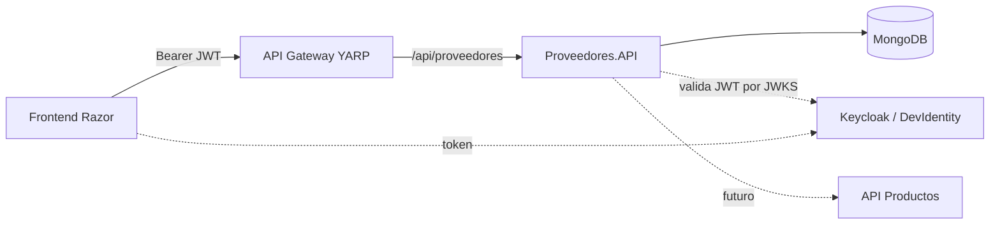

# Integración con el Grupo 2 (Keycloak, Gateway y frontend definitivos)

## 1. Arquitectura

El Gateway reenvía `Authorization`; **la API valida** firma, issuer, audience y expiración, y comprueba roles.

## 2-3. Definitivo vs temporal
| Definitivo | Temporal |
|---|---|
| `Servicio1.Proveedores/*`, MongoDB | `ApiGateway/ApiGateway.Demo`, `Frontend/Frontend.Demo`, `DevIdentity/DevIdentity.Demo` |

## 4-5. Archivos
| Archivo | Estado | Responsable | Qué modificar | Cómo verificar |
|---|---|---|---|---|
| `Servicio1.Proveedores/Proveedores.API/appsettings.json` (`Authentication:Jwt`) | Preparado | Grupo 2 | **Obligatorio:** Authority, Audience, RoleClaimPaths, RoleMapping | `GET /api/proveedores` con token real → 200 |
| `Proveedores.API/Security/KeycloakRolesClaimsMapper.cs` | Preparado | Grupo 2 | Opcional: solo si la estructura de claims difiere | `KeycloakRolesClaimsMapperTests` |
| `Proveedores.API/Security/ConfigureJwtBearerOptions.cs` | Conservar | Grupo 1 | Nada | 401 sin token / token inválido |
| `Proveedores.API/Security/HttpContextCurrentUser.cs` | Preparado | Grupo 2 | Opcional: `UserIdClaim` | `idUsuarioAdmin` = `sub` del token |
| `ApiGateway/ApiGateway.Demo/appsettings.json` | Temporal | Grupo 2 | Agregar rutas/clusters; quitar `dev-auth-route` | `curl` al Gateway |
| `Frontend/Frontend.Demo/Services/DemoPerfilSession.cs`, `DemoTokenProvider.cs` | Temporal | Grupo 2 | **Obligatorio al integrar:** eliminar y usar el token del usuario real | Login real → llamadas con su token |
| `Frontend/Frontend.Demo/Services/ProveedoresApiClient.cs` | Conservar | Grupo 2 | Sustituir el origen del token (`DemoTokenProvider`) | CRUD desde UI |
| `DevIdentity/DevIdentity.Demo/*`, servicio `dev-identity` en `docker-compose.yml` | Temporal | Grupo 2 | Eliminar | La API sigue validando contra Keycloak |
| Docker y variables de despliegue | Pendiente | Ambos | Se incorporarán en un commit independiente | Pendiente de entrega Docker |
| `Proveedores.Infrastructure/Integrations/ProductoApiAdapter.cs` | Pendiente (futuro) | Futura entrega | Activar `ProductosApi__*` y usar el puerto | `ProductoApiAdapterTests` |

**Cambios obligatorios para Keycloak:** Authority, Audience, RoleMapping/RoleClaimPaths, quitar identidad temporal. **Opcionales:** UserIdClaim, rutas del Gateway. **Pendientes de futuras entregas:** integración con Productos (§19).

## 6-7. Keycloak, Authority y Audience
1. Cliente/audiencia `proveedores-api` en el realm; agregue un *Audience mapper* para que el token incluya `aud=proveedores-api`.
2. `Authentication__Jwt__Authority=https://<host>/realms/<realm>` (la API descubre `/.well-known/openid-configuration` y el JWKS).
3. `Authentication__Jwt__RequireHttpsMetadata=true` en producción. El `iss` del token debe ser idéntico a Authority.

## 8. Roles
Roles internos: `Administrador`, `Cajero`. Mapeo por configuración:
```
Authentication__Jwt__RoleClaimPaths__0=realm_access.roles
Authentication__Jwt__RoleClaimPaths__1=resource_access.proveedores-api.roles
Authentication__Jwt__RoleMapping__Administrador__0=admin
Authentication__Jwt__RoleMapping__Cajero__0=cajero
```
Permisos: lectura = Administrador o Cajero; escritura = solo Administrador.

## 9. Claim `sub`
La auditoría guarda el `sub` (cadena) en `idUsuarioAdmin` / `idUsuarioActualizacion`. No se asume entero.

## 10-11. Gateway y frontend definitivo
Agregue rutas en `ReverseProxy` del Gateway. El frontend definitivo debe enviar `Authorization: Bearer <JWT>` a `{Gateway}/api/proveedores` y mostrar los mensajes `detail` de los ProblemDetails (código `code` estable).

## 12-13. Ejemplos
```http
GET /api/proveedores?busqueda=demo&estado=Activos&ordenarPor=Nombre&descendente=false&pagina=1&tamanoPagina=10
Authorization: Bearer <token>            → 200 { items, pagina, tamanoPagina, total, totalPaginas }

POST /api/proveedores   {"nombreEmpresa":"Lácteos Sur","numeroEmpresa":"71234567","correoReferencia":"a@b.com","esAutogestionado":false}
                                         → 201 + Location | 400 datos inválidos | 409 nombre activo duplicado
PUT /api/proveedores/{id}                → 200 | 404 | 409 (también si está desactivado)
DELETE /api/proveedores/{id}             → 204 | 404 | 409 (ya desactivado)
PATCH /api/proveedores/{id}/reactivar    → 200 | 404 | 409 (ya activo o nombre tomado)
Sin token → 401 · Cajero en escritura → 403
```

## 14-15. Variables y Docker
Docker y sus archivos no se incluyen en esta publicación inicial. Utilizar el arranque local del README; las variables Docker se acordarán en una entrega posterior.

## 16. Pruebas de integración
`scripts/smoke-test.sh` (Gateway) y `dotnet test` (ver README). Con Keycloak real: obtener token del realm y repetir los casos 401/403/200.

## 17. Errores frecuentes
| Síntoma | Causa / solución |
|---|---|
| 401 con token válido | `iss` ≠ Authority, `aud` ≠ Audience o reloj desfasado |
| 403 siendo admin | Rol no mapeado: revise RoleClaimPaths/RoleMapping y decodifique el token |
| La API no arranca por metadatos | Authority inalcanzable desde el contenedor (use el nombre de servicio Docker) |
| 409 al reactivar | Existe otro activo con el mismo nombre |
| Gateway 502/503 | Dirección del cluster incorrecta (en Docker usar `http://proveedores-api:8080/`) |

## 18. Retirar la autenticación temporal
1. Quite `dev-identity` de `docker-compose.yml` y el `depends_on` que lo menciona.
2. Quite `dev-auth-route` y `dev-identity-cluster` del Gateway.
3. Elimine `DevIdentity/` y, en el frontend, `DemoPerfilSession`/`DemoTokenProvider` y el selector de perfil.
4. Configure Authority/Audience de Keycloak. Domain, Application y el CRUD no cambian.

## 19. Conectar la API de Productos (futuro)
Contrato **propuesto** (a acordar): `GET api/productos/proveedor/{proveedorId}/activos/conteo` → `200 {"cantidad": n}`.
1. `ProductosApi__Enabled=true`, `ProductosApi__BaseUrl=http://productos-api:8080/`.
2. Inyectar `IProductoApiClient` en `DesactivarProveedor`; si devuelve `true` → error Conflict; si devuelve Failure → propagar (503), nunca asumir `false`.
3. Agregar pruebas con handler falso (ver `ProductoApiAdapterTests`).

## 20. Correcciones de estabilidad local (18 de noviembre de 2026)
- PUT, DELETE y PATCH pueden devolver 409 con `code=Proveedor.CambioConcurrente` cuando otra solicitud modificó el documento entre lectura y escritura. El cliente debe recargar antes de volver a intentar. No se modifica la forma de los DTOs ni se exige enviar una versión desde el cliente; este control protege operaciones solapadas en el servidor, no formularios antiguos enviados después de una operación ya completada.
- MongoDB almacena `version` (Int64), incrementada de forma atómica junto con cada actualización. Documentos sin campo equivalen a 0 y se actualizan sin migración masiva. Todos los escritores deben usar este repositorio; una edición manual de MongoDB debe respetar la versión.
- El frontend temporal renueva solo ante 401, manteniendo el perfil y reconstruyendo cuerpo y encabezados. Reintenta una vez; no repite 403, fallos técnicos ni respuestas de negocio. La renovación se serializa por perfil y una respuesta tardía no elimina un token ya renovado. Un segundo 401 se muestra al usuario y también invalida su token. La caché JWKS de la API puede demorar el reconocimiento de una clave recién generada.
- Parámetros extremos de paginación se normalizan para mantener `(pagina-1)*tamanoPagina` dentro de Int32; se devuelve la página normalizada. `totalPaginas` se satura en Int32.MaxValue para conservar el contrato numérico existente.
- El contrato propuesto de Productos requiere `cantidad` presente, de tipo entero de 32 bits y >= 0. Campos ausentes, nulos, cadenas, fracciones y valores fuera de rango devuelven Failure de integración; no se asumen cero productos. No se ha activado la integración ni Keycloak real.
- Sin cambios de puertos, variables de entorno, claims ni rutas. Docker Compose no se ha modificado.

## 21. Frontend PuntoMarket (demostración)
- Nuevas páginas de frontend: `/Login`, `/Logout` (POST), panel `/Index` y `/`. Se conserva `/Proveedores`. No cambian rutas ni DTOs del microservicio.
- `DemoPerfilRequeridoFilter` verifica la presencia de un perfil en la sesión antes de ejecutar PageModels protegidos. Login solicita JWT mediante el `DemoTokenProvider` existente antes de activar el perfil. No se añade otro esquema de autenticación; la API sigue validando JWT y roles. Retirar también este filtro y Login/Logout de demo al integrar la identidad definitiva.
- El menú permite cambiar perfil y cerrar sesión con antiforgery. Logout elimina solo el perfil de la sesión actual; no invalida tokens compartidos por otras sesiones demo. Los errores 401/403/409 se conservan en el cliente; un error de guardado mantiene el modal y los datos.
- El panel usa `Total` de tres solicitudes (Todos, Activos, Inactivos) con tamaño 1. No deriva totales de los elementos de la primera página ni muestra ceros inventados si el servicio falla.
- La vista principal filtra Activos; Eliminados usa Inactivos. Eliminar llama al DELETE existente, Reactivar al PATCH existente. El frontend oculta y rechaza acciones de Cajero y la API conserva la autorización definitiva.
- Desde el fortalecimiento del 19 de noviembre, `ProveedoresApiClient.BuscarAsync` delega una consulta paginada a la API. El parámetro existente `busqueda` filtra nombre, teléfono y correo en MongoDB antes de ordenar y paginar; no se descargan todas las páginas en el frontend.
- No cambian puertos de uso habitual, variables, claims, Docker, Keycloak ni datos iniciales. Los recursos de Bootstrap, iconos e Inter se sirven localmente. La identidad continúa marcada DEMO TEMPORAL.

## 22. Validaciones reforzadas (19 de noviembre de 2026)
- Sin cambios en rutas, DTOs de proveedores, puertos, claims o variables. Domain conserva la autoridad sobre nombre, teléfono y correo; ver `VALIDACIONES_Y_SEGURIDAD.md`.
- POST/PUT inválidos conservan HTTP 400 y `code`/`detail`. Se añade el miembro opcional `errors` a ProblemDetails: objeto con claves `nombreEmpresa`, `numeroEmpresa`, `correoReferencia` y listas de mensajes. El frontend reconoce únicamente esas claves y conserva el modal y los valores.
- JSON o parámetros de tipo incorrecto devuelven 400 con `code=Solicitud.Invalida` y un mensaje controlado. Identificadores malformados en la API conservan 404; no se cambió esa semántica.
- `busqueda`: hasta 150 caracteres tras recorte; blanco significa sin filtro; controles/invisibles inválidos devuelven 400. Se amplía la búsqueda existente al correo, sin parámetros nuevos. Nombre compara sin tildes; correo y teléfono se buscan literalmente, ignorando mayúsculas. Los metacaracteres se escapan; no son operadores MongoDB.
- Estado/orden numéricos fuera del enum devuelven 400. Se conservan límites de página/tamaño, orden global previo a paginación y desempate `_id` ascendente.
- No se migra ningún dato ni se añade un validador de colección que impida leer documentos históricos. Los datos históricos incompatibles requieren revisión explícita; no se publican registros personales ni se corrigen automáticamente.
- La prohibición de desactivar proveedores con productos activos continúa pendiente de la integración HTTP; no está activada.

## 23. Ajustes finales de usabilidad
- Política comercial vigente: teléfono nacional de 8 dígitos ASCII, inicio 4/6/7, sin prefijos +591 ni 591. Misma forma string y mismas respuestas Result/400; no se migran datos.
- Búsqueda: el parámetro `busqueda` mantiene forma y campos; ahora ordena grupos por prefijo de nombre, parcial de nombre y solo teléfono/correo antes de aplicar el criterio solicitado y `_id` estable. Sin búsqueda se conserva el orden habitual. Sin cambios de índices, puertos, rutas, DTOs ni variables.
- UI: solo Nombre A-Z/Z-A, con los parámetros existentes `ordenarPor=Nombre` y `descendente`. Otros criterios HTTP siguen disponibles para clientes internos. Búsqueda por fetch al GET Razor existente con debounce 300 ms y botón Limpiar; no se expone una ruta nueva.
- Inventario, evidencia y limitaciones: `AJUSTES_USABILIDAD.md`.

## 24. Docker Compose de desarrollo
La fase Docker utiliza el Compose único con proyecto puntomarket y servicios frontend, gateway, proveedores-api, identity-dev y mongodb. Los destinos YARP se sobrescriben por DNS interno, conservando rutas. MetadataAddress opcional separa transporte OIDC interno del issuer público; las validaciones JWT permanecen activas. No se integra Keycloak ni Usuarios. Ver `GUIA_DOCKER_PUNTOMARKET.md` para puertos, redes, volúmenes y comandos. Esta sección describe la fase actual pendiente de revisión; las notas anteriores de Docker pendiente corresponden a la publicación inicial.
