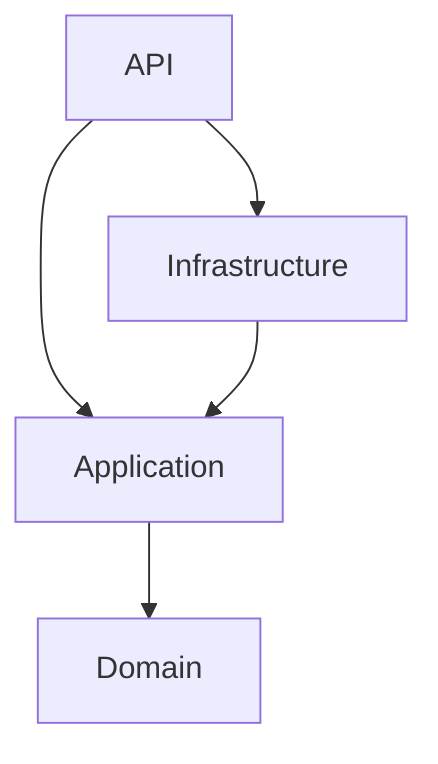

# Patrones y arquitectura (guía de defensa)

## Clean Architecture
| Capa | Contiene | Puede depender de | Prohibido |
|---|---|---|---|
| Domain | `Proveedor`, `Result`, `Error`, creadores, validador | nada | MongoDB, ASP.NET, HTTP |
| Application | casos de uso, DTOs, puertos | Domain | Infrastructure, API |
| Infrastructure | Mongo, adaptadores, seed, DI | Application (y Domain) | API |
| API | controllers, JWT, Swagger | todas (raíz de composición) | lógica de negocio |

**Flujo HTTP:** Gateway → JwtBearer (firma/issuer/audience/exp) → mapeo de roles → política → Controller → caso de uso → dominio (`Result`) → puerto → adaptador Mongo → `Result` → `ResultHttpMapper` → 200/201/204/400/404/409.
**Flujo de crear:** `ProveedoresController.Crear` → `CrearProveedor` (lee `sub` por `ICurrentUser`) → `ProveedorCreatorSelector` → `ProveedorCreator.Crear` (valida) → `ExisteActivoConNombreAsync` → `MongoProveedorRepository.AgregarAsync` (índice único como red de seguridad concurrente).

## Result (`Domain/Common/Result.cs`)
`Result` / `Result<T>` con `IsSuccess`, `IsFailure`, `Value`, `Error`, `Success()`, `Failure()`. `Error(Code, Message, Type)`. Ejemplo: `ProveedorValidador.Validar` devuelve `Failure(NombreRequerido)` en vez de lanzar. Justificación: las validaciones esperadas no son excepcionales, son parte del flujo; el mapeo a HTTP es uniforme (`ResultHttpMapper`). Probado en `ResultTests`.

## Adapter
- Puerto: `IProveedorRepository` (Application). Adaptador: `MongoProveedorRepository` traduce `IMongoCollection<ProveedorDocument>` y la violación de índice (`DuplicateKey`) a `Result.Failure(NombreDuplicado)`.
- Puerto: `IProductoApiClient`. Adaptador: `ProductoApiAdapter` traduce HTTP/JSON de Productos a `Result<bool>` (preparado, sin invocar).
- Diferencia con Repository: Repository es el rol de colección de dominio; Adapter es la técnica que convierte una interfaz ajena (driver Mongo, HTTP) a la que espera Application. Diferencia con DI: DI entrega la dependencia; el Adapter es lo que se entrega.

## Factory Method (`Domain/Creators`)
Creador `ProveedorCreator` (método plantilla `Crear` + método fábrica abstracto `InstanciarProveedor`), creadores concretos `ProveedorEstandarCreator` y `ProveedorAutogestionadoCreator`, producto `Proveedor` (constructor `internal`: solo los creadores pueden instanciarlo, garantizando invariantes). Se combina con Result. Justificación: algoritmo de creación común + paso variable (tipo de proveedor según `esAutogestionado` del SQL); nuevos tipos = nueva subclase sin tocar casos de uso (OCP).

## Singleton (`Infrastructure/DependencyInjection.cs`)
`services.AddSingleton<IMongoClient>(...)`: una instancia por proceso, reutilizada por todas las solicitudes (el cliente es thread-safe y gestiona el pool). Es el ciclo de vida Singleton del contenedor DI, no el Singleton clásico (constructor privado + campo estático), más testeable. No se comparte entre contenedores Docker: cada proceso tiene su cliente. Verificación: `SingletonLifetimeTests` (misma instancia en distintos scopes y descriptor `Singleton`).

## SOLID
- **S:** casos de uso de una sola responsabilidad (`CrearProveedor`…); `ProveedorValidador` solo valida.
- **O:** nuevos creadores sin modificar `ProveedorCreator.Crear`.
- **L:** `ProveedorEstandarCreator`/`AutogestionadoCreator` sustituyen a `ProveedorCreator`; `InMemoryProveedorRepository` sustituye a Mongo en pruebas.
- **I:** puertos pequeños (`ICurrentUser`, `IProductoApiClient`, `IProveedorRepository`), una interfaz por caso de uso.
- **D:** Application depende de abstracciones; Infrastructure las implementa y `Program.cs` las compone.

## Diagramas C4 para el informe
Nivel 1 (Contexto): Administrador y Cajero → Sistema Micromercado; Keycloak (Grupo 2) como sistema externo. Nivel 2 (Contenedores): Frontend Razor, API Gateway YARP, Proveedores.API (.NET 10), MongoDB, Keycloak/DevIdentity. Nivel 3 (Componentes de Proveedores.API): Controller, casos de uso, Dominio, Repositorio Mongo (Adapter), Adaptador Productos, Seguridad JWT. Nivel combinado 1-2-3 en una sola vista. Incluya tecnologías (ASP.NET Core 10, MongoDB.Driver, YARP, Docker) en cada caja. Diagramas de clases sugeridos: `ProveedorCreator` y subclases, `Result<T>`, puertos y adaptadores.
