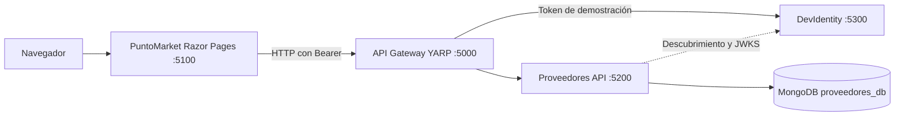

# ProyectoFinal_Arquitectura_EquipoDinamita

**PuntoMarket** es una aplicación académica de gestión de proveedores para un micromercado. Incluye un microservicio independiente con Clean Architecture y MongoDB, un API Gateway YARP y un frontend ASP.NET Core Razor Pages.

El proyecto admite ejecución local y una pila Docker Compose de desarrollo con cinco servicios. Keycloak, el módulo Usuarios y otros microservicios se integrarán progresivamente cuando sus contratos estén disponibles.

## Inicio rápido con Docker

Con Docker Desktop abierto y motor Linux disponible, desde la raíz:

```powershell
docker compose up --build -d
docker compose ps
```

Abrir **http://localhost:5100**. MongoDB Docker usa un volumen nuevo y el seed de siete proveedores; no copia la base de Windows. Compass conecta a mongodb://localhost:27018. Si los puertos están ocupados por dotnet run, consultar las variables opcionales de `.env.example`.

Ver [GUIA_DOCKER_PUNTOMARKET.md](GUIA_DOCKER_PUNTOMARKET.md) para instalación, JWT público/interno, persistencia, logs, mantenimiento y pruebas. `docker compose down` conserva los volúmenes; no usar `down -v` para reiniciar. Esta fase aún no se ha publicado hasta su revisión.

## Arquitectura



El frontend consume las APIs mediante el Gateway. Cada microservicio conserva su propia base de datos y valida sus permisos. El Gateway actual enruta y propaga Authorization; no valida JWT ni contiene reglas de negocio.

## Tecnologías

- .NET 10 y ASP.NET Core Web API / Razor Pages.
- MongoDB Community Server y MongoDB.Driver 3.13.0.
- YARP ReverseProxy 2.3.0.
- JWT con firma RSA y descubrimiento/JWKS en la identidad de demostración.
- xUnit, ASP.NET Core TestServer y pruebas con MongoDB real.
- Bootstrap 5.3.3, Bootstrap Icons e Inter servidos localmente con sus licencias.

## Estructura

```text
Proyecto_Microservicios.slnx
Servicio1.Proveedores/
  Proveedores.Domain/           Entidad, validaciones, Result y Factory Method
  Proveedores.Application/      Casos de uso, DTOs y puertos
  Proveedores.Infrastructure/   MongoDB, índices, seed y adaptadores
  Proveedores.API/              Endpoints, JWT, roles y composición DI
  Proveedores.Tests/            Pruebas unitarias y de integración
ApiGateway/ApiGateway.Demo/     Enrutamiento HTTP hacia los microservicios
Frontend/Frontend.Demo/         PuntoMarket Razor Pages
DevIdentity/DevIdentity.Demo/   Emisor de identidad temporal para desarrollo
scripts/                       Pruebas JavaScript y smoke test opcional
GUIA_INTEGRACION_MICROSERVICIOS.md
```

Domain no depende de MongoDB ni HTTP; Application depende de Domain; Infrastructure implementa los puertos y API compone las capas. MongoClient tiene ciclo de vida Singleton por DI. Se mantienen los patrones **Result, Adapter, Factory Method y Singleton**.

## Requisitos previos

- Windows 10 o un entorno compatible con .NET 10.
- .NET 10 SDK: comprobar con `dotnet --version`.
- MongoDB Community Server disponible en `localhost:27017`.
- Git para clonar el repositorio.
- Node.js moderno (18 o superior) para ejecutar las pruebas JavaScript, sin instalar paquetes npm.

## Obtener y preparar el proyecto

```powershell
git clone https://github.com/JesusxAriel/ProyectoFinal_Arquitectura_EquipoDinamita.git
Set-Location ProyectoFinal_Arquitectura_EquipoDinamita
dotnet restore Proyecto_Microservicios.slnx
dotnet build Proyecto_Microservicios.slnx --no-restore
```

## MongoDB local

Si MongoDB se instaló como servicio de Windows:

```powershell
Get-Service MongoDB
# Solo si está detenido; puede requerir una terminal de Administrador:
Start-Service MongoDB
```

Si se instaló sin servicio, iniciar `mongod` con una carpeta de datos local propia según la instalación. No guardar sus datos, exportaciones ni credenciales dentro del repositorio.

La configuración local sin autenticación está en `Servicio1.Proveedores/Proveedores.API/appsettings.json`:

| Opción | Valor predeterminado |
|---|---|
| Mongo:ConnectionString | mongodb://localhost:27017 |
| Mongo:DatabaseName | proveedores_db |
| Mongo:ProveedoresCollection | proveedores |
| Mongo:InitializeOnStartup | true |
| Mongo:SeedEnabled | true |

No hace falta importar SQL ni copiar la base de quien desarrolló el proyecto. La API crea la colección y sus índices al iniciar. Para usar otra base local, establecer antes de iniciar la API:

```powershell
$env:Mongo__DatabaseName = 'proveedores_demo_local'
$env:Mongo__ConnectionString = 'mongodb://localhost:27017'
```

Si el servidor exige autenticación, configurar la conexión únicamente mediante variables de entorno o un almacén local de secretos. No poner contraseñas en appsettings versionados. Los archivos `.env` no se cargan automáticamente por esta aplicación; usar variables de PowerShell o configuración de ASP.NET Core.

## Ejecutar los cuatro servicios

Desde la raíz, abrir cuatro terminales. Los perfiles de launchSettings configuran Development y los puertos locales.

**Terminal 1 — identidad temporal**

```powershell
dotnet run --project DevIdentity/DevIdentity.Demo
```

**Terminal 2 — API de Proveedores**

```powershell
dotnet run --project Servicio1.Proveedores/Proveedores.API
```

**Terminal 3 — Gateway**

```powershell
dotnet run --project ApiGateway/ApiGateway.Demo
```

**Terminal 4 — frontend**

```powershell
dotnet run --project Frontend/Frontend.Demo
```

| Componente | URL |
|---|---|
| PuntoMarket / Login | http://localhost:5100/Login |
| Módulo Proveedores | http://localhost:5100/Proveedores |
| Gateway / API Proveedores | http://localhost:5000/api/proveedores |
| Swagger de Proveedores, en Development | http://localhost:5200/swagger |
| Identidad demo / descubrimiento | http://localhost:5300/realms/proveedores-dev/.well-known/openid-configuration |
| MongoDB local | localhost:27017 |

Todos los procesos HTTP exponen `/health` en su propio puerto. Estos endpoints comprueban la respuesta del proceso; no garantizan disponibilidad de toda la cadena ni de MongoDB.

## Login temporal y permisos

En `/Login`, seleccionar **Administrador** o **Cajero**. No hay registro, contraseña ni autenticación personal real: el selector obtiene un JWT de una de dos identidades fijas de DevIdentity.

- Administrador: consulta, crea, edita, desactiva y reactiva proveedores.
- Cajero: únicamente consulta, busca y ordena proveedores.
- La API valida firma, emisor, audiencia, vigencia y roles; sin token responde 401 y sin permisos 403.
- El frontend guarda el perfil en sesión y el token en caché del servidor por perfil. No utiliza localStorage para el JWT.
- Ante 401 renueva el token demo y reintenta una vez. Logout elimina el perfil de la sesión; no es revocación real por usuario.
- Reiniciar DevIdentity cambia su clave RSA y puede invalidar tokens anteriores hasta renovar y refrescar JWKS.

**DevIdentity es exclusivamente para desarrollo.** No publicar este selector como login real. Keycloak y el manejo real de sesión/tokens se integrarán después, sin desactivar las validaciones de la API.

## Funcionalidades de Proveedores

CRUD con eliminación lógica y reactivación, auditoría y concurrencia optimista mediante `version`. No se editan inactivos y los nombres normalizados son únicos entre activos gracias a un índice único parcial.

Nombre obligatorio de hasta 150 caracteres; teléfono string nacional de 8 dígitos comenzando por 4/6/7, sin +591; correo opcional de hasta 150. Domain es la autoridad de validación. Razor codifica salida y el repositorio utiliza filtros tipados y búsqueda literal escapada.

El buscador funciona con debounce de 300 ms, botón Limpiar, prioridad de coincidencias y paginación remota. El desplegable ofrece Nombre A-Z / Nombre Z-A. Los formularios conservan valores y muestran errores por campo.

## Seed de los siete proveedores

En una base vacía, el primer arranque de la API inserta:

1. PIL Andina S.A.
2. EMBOL S.A. (Coca-Cola).
3. Sofía SHE S.A.
4. CBN (Cervecería Boliviana Nacional).
5. Unilever Bolivia.
6. Industrias Venado S.A. (Kris).
7. Arcor Bolivia.

Código: [ProveedorSeeder.cs](Servicio1.Proveedores/Proveedores.Infrastructure/Mongo/ProveedorSeeder.cs). Utiliza marcas `seed-proveedor-N`, upsert y `$setOnInsert`: reiniciar no duplica los siete registros ni sobrescribe cambios realizados por el usuario. Los ObjectId los genera MongoDB en la base de cada compañero.

Para desactivar el seed en una instalación propia, usar `Mongo__SeedEnabled=false`. `Mongo__InitializeOnStartup=false` desactiva el inicializador completo. La colección personal y los proveedores añadidos manualmente **no forman parte del repositorio**.

## Pruebas

Pruebas sin exigir MongoDB (las de persistencia se omiten si no se configura su variable):

```powershell
dotnet test Servicio1.Proveedores/Proveedores.slnx
```

Suite completa con MongoDB real local:

```powershell
$env:PROVEEDORES_TEST_MONGO = 'mongodb://localhost:27017'
dotnet test Servicio1.Proveedores/Proveedores.slnx
```

Las pruebas generan bases temporales con nombre único y eliminan exclusivamente esas bases. No utilizan `proveedores_db` como base de pruebas. `MongoSeedApiTests` comprueba desde una base vacía la consulta de los siete proveedores mediante la API real de pruebas y la igualdad BSON completa después de reiniciar el host.

Pruebas JavaScript:

```powershell
node scripts/probar-validaciones-frontend.cjs
node scripts/probar-busqueda-dinamica.mjs
```

El smoke test Bash es opcional y realiza escrituras: ejecutarlo únicamente contra una instancia destinada a pruebas con una base temporal, nunca contra datos personales. Las evidencias de ejecución, logs y resultados locales quedan fuera de Git.

## Integrar otros microservicios

Consultar la [Guía de integración de microservicios](GUIA_INTEGRACION_MICROSERVICIOS.md) y los [acuerdos de integración](INTEGRACION_GRUPO2.md).

Cada nuevo servicio conserva su base. Añadir su cluster/rutas reales en YARP, un cliente HTTP independiente en el frontend, sus páginas Razor y el enlace de navegación. No es necesario modificar Domain, los casos de uso o MongoDB de Proveedores. El contrato de Usuarios aún debe entregarlo el Grupo 2; no se inventan endpoints ni permisos.

Documentación adicional: [Arquitectura y patrones](PATRONES_Y_ARQUITECTURA.md), [API de Proveedores](Servicio1.Proveedores/README.md) y [Frontend PuntoMarket](Frontend/Frontend.Demo/README.md).

## Alcance y pendientes

- La dockerización está preparada en una fase independiente, pendiente de revisión y publicación; ver la guía Docker.
- Keycloak real, Usuarios y otros CRUD están pendientes de contratos e integración.
- El adaptador de Productos existe, pero aún no se invoca para impedir la baja de un proveedor con productos activos.
- `version` protege operaciones solapadas del servidor, no formularios antiguos enviados después de una actualización terminada.
- La búsqueda de subcadenas puede recorrer documentos; no representa un buscador de costo constante.
- La identidad y sesión demo en memoria no son una solución de producción.

## Seguridad de publicación

Se conservan configuraciones locales sin secretos. `.gitignore` excluye bin/obj, artefactos, logs, `.env`, claves/certificados privados, exportaciones BSON y datos locales. Las herramientas e informes de operaciones sobre la base personal se mantienen locales y no se publican. `.env.example` se versiona solo como plantilla sin secretos; `.env` permanece excluido. Las claves simétricas explícitamente etiquetadas de pruebas solo pertenecen a TestServer; DevIdentity genera su clave privada en memoria.

## Verificación previa a la publicación

Restore correcto y build completo con **0 errores y 0 advertencias**. Suite ejecutada con MongoDB local: **211 pruebas aprobadas, 0 fallidas y 0 omitidas**, incluidas 14 pruebas de persistencia/API con MongoDB real. Pasaron también los 60 casos JavaScript de formulario y las pruebas del buscador dinámico.

La prueba de seed/API utiliza una base temporal vacía, consulta los siete proveedores por HTTP y reinicia el host para verificar que los documentos BSON permanecen iguales. No requiere la base personal ni publica sus documentos. Los resultados de ejecución son locales y no se versionan.

## Verificación de la fase Docker (pendiente de revisión, sin commit/push)

Cinco servicios saludables, cuatro imágenes .NET construidas, JWT/roles/CRUD por Gateway y persistencia tras reinicios y down/up sin borrar volúmenes comprobados. Build local: 0 errores/advertencias; 215 pruebas .NET aprobadas con MongoDB Docker, sin fallos ni omisiones; pruebas JavaScript correctas.

En el equipo de revisión ya estaban ocupados los puertos habituales: `.env` local (ignorado) mantiene frontend en http://localhost:15100, Gateway 15000, API 15200 e identidad 15300. Un clon sin ese archivo utiliza 5100/5000/5200/5300. El volumen de revisión conserva los siete seed activos y un registro de prueba inactivo; MongoDB de Windows permanece independiente. Detalles e inventario en la guía Docker.
