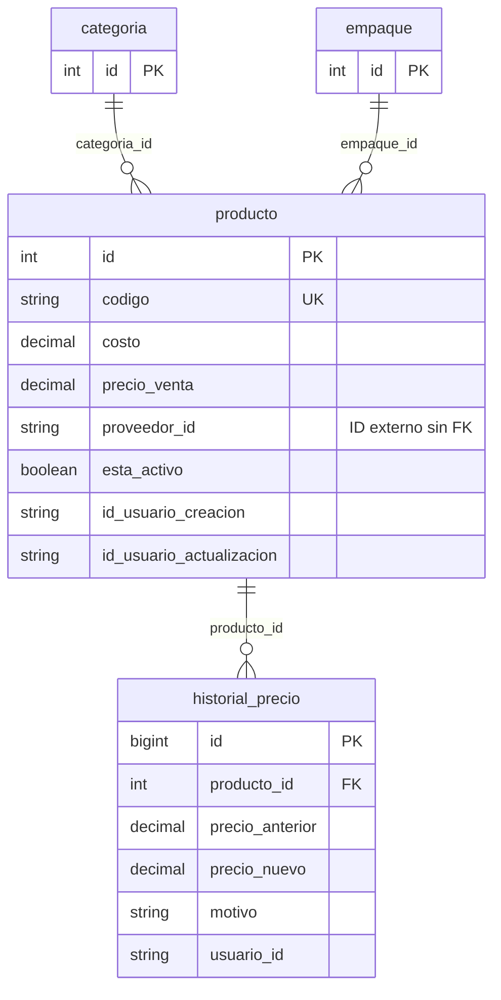

# Servicio3.Productos — EC3

Microservicio .NET 10 con PostgreSQL y arquitectura hexagonal. Se completa el esqueleto existente; Domain no tiene paquetes externos y Application solo referencia Domain. El frontend común consume el Gateway con el JWT de la sesión; no accede al puerto de Productos ni a su base.

## Contrato HTTP

Prefijo `/api/productos` en API y Gateway. Lectura: Administrador o Cajero. Escritura: solo Administrador. JWT obligatorio también en la API: firma, issuer, audience y vigencia. Auditoría: claim `sub` como texto, nunca un campo del formulario.

| Método | Ruta | Resultado |
|---|---|---|
| GET | `/api/productos` | Página `{items,pagina,tamanoPagina,total,totalPaginas}` |
| GET | `/api/productos/{id:int}` | Producto, incluido inactivo |
| GET | `/api/productos/catalogos` | `{categorias:[{id,nombre}],empaques:[{id,nombre}]}` |
| POST | `/api/productos` | 201, producto y Location |
| PUT | `/api/productos/{id:int}` | 200, producto actualizado |
| DELETE | `/api/productos/{id:int}` | 204, baja lógica |
| GET | `/api/salud` | 200 anónimo; Gateway lo expone en `/api/productos/salud` |

Listado: `busqueda` (código o nombre, literal, hasta 150 caracteres), `estado=Activos|Inactivos|Todos`, `ordenarPor=Nombre|Codigo|Costo|PrecioVenta|FechaCreacion`, `descendente=false`, `pagina=1`, `tamanoPagina=10` (normalizado a 1–100). Desempate por ID; conteo y página comparten una instantánea RepeatableRead. Ordenación mediante lista permitida y parámetros SQL para los valores.

Cuerpo de alta y edición (PUT completo):

```json
{"codigo":"SKU-001","nombre":"Producto de ejemplo","costo":10.00,"precioVenta":15.00,"categoriaId":1,"empaqueId":1,"proveedorId":"ID-TEXTO-DEL-PROVEEDOR","motivoCambioPrecio":null}
```

Usar IDs reales obtenidos de los selectores. No enviar usuario, estado ni fechas. Salida: los campos comerciales más `id`, `estaActivo`, `idUsuarioCreacion`, `idUsuarioActualizacion`, `fechaCreacion` y `fechaActualizacion` UTC. Al cambiar precio de venta, enviar `motivoCambioPrecio`; el historial guarda precio anterior/nuevo, motivo, usuario y fecha en la misma transacción de la edición. No se agrega historial por alta o por cambio de costo sin cambio del precio de venta.

Errores de negocio usan ProblemDetails con `code` estable, `detail` en español y `errors` por campo cuando corresponde: 400 validación/catálogos/proveedor inválido, 404 producto inexistente, 409 código duplicado o producto inactivo, 503 persistencia o Proveedores no disponible. Identidad ausente/inválida: 401; rol insuficiente: 403. Los errores técnicos no exponen SQL, credenciales ni respuestas internas.

## Reglas y supuestos verificables

El código previo de este servicio solo contenía Result y salud: no había límites comerciales anteriores ni SQL de precios que recuperar. Se adoptan y documentan estos supuestos para revisión del equipo:

- Código de negocio único para todo el historial de productos, incluidos inactivos. Trim y mayúsculas ASCII; 1–50 caracteres, comienza con letra/número y admite punto, guion y guion bajo. Evita reutilizar una identidad comercial desactivada. No se exige que sea EAN ni se inventa un código de barras.
- Nombre obligatorio hasta 150 caracteres, sin controles ni HTML. Código y nombre no identifican tipos de producto artificiales.
- Costo positivo y venta mayor o igual al costo, ambos con dos decimales como máximo, hasta 9.999.999.999,99 por `numeric(12,2)`. No se supone margen mínimo/máximo ni porcentaje comercial.
- Categoría y empaque deben existir en la misma base. Proveedor es un ID externo de texto de hasta 100 caracteres. No hay FK externa, tabla maestra de Proveedores ni conexión MongoDB.
- Motivo obligatorio si cambia la venta, hasta 250 caracteres sin controles ni HTML. No se editan productos inactivos; no hay reactivación en este CRUD.
- La fila se bloquea durante edición/baja. Se vuelve a validar el precio contra la fila bloqueada y se guarda historial atómicamente. No se implementa ETag: dos formularios antiguos pueden tener la política de última escritura; cada cambio efectivo de precio queda auditado.
- La comprobación remota del proveedor es previa a la transacción local. No hay transacción distribuida: un proveedor puede cambiar de estado después de validarlo. No se activa el bloqueo de bajas de Proveedores.
- Sin stock, sincronización, lotes ni ventas.

## Esquema y migración



`src/PuntoMarket.Productos.Adapters.Out.Persistence/Migrations/001_productos.sql` es la migración 001 aditiva/repetible, integrada como recurso del ensamblado. `ProductosDatabaseInitializer.cs` la ejecuta en transacción y con advisory lock por base; `productos_migracion` registra la versión. No borra datos. `CREATE TABLE IF NOT EXISTS` presupone una instalación vacía o previamente creada por esta migración; no reconcilia esquemas ajenos incompatibles. Futuras modificaciones requieren nuevas migraciones versionadas.

`Migrations/Seed_desarrollo.sql` inserta únicamente categorías (Alimentos, Bebidas, Limpieza) y empaques (Unidad, Caja, Bolsa) con ON CONFLICT; no sobreescribe nombres ni siembra proveedores/productos ficticios. No asumir IDs de catálogo: consultar `/catalogos`.

## Evidencia de los patrones

Rutas relativas a Servicio3.Productos:

| Patrón | Archivos y uso real |
|---|---|
| Singleton | `src/PuntoMarket.Productos.Adapters.In.Api/Program.cs`: `AddSingleton<NpgsqlDataSource>`. Un pool por proceso, conexiones abiertas y liberadas por operación/transacción. No hay conexión abierta compartida. |
| Factory Method | `src/PuntoMarket.Productos.Application/Ports/Out/PuertosDeSalida.cs`: creador abstracto `ProductoRepositoryCreator.Crear`; `src/PuntoMarket.Productos.Adapters.Out.Persistence/PostgresProductoRepository.cs`: override en `PostgresProductoRepositoryCreator`. DI resuelve IProductoRepository invocando el creador en Program.cs. |
| Adapter | `src/PuntoMarket.Productos.Adapters.In.Api/Controllers/ProductosController.cs` delega a los puertos de entrada; `PostgresProductoRepository.cs` implementa IProductoRepository; `src/PuntoMarket.Productos.Adapters.In.Api/Integrations/ProveedorApiAdapter.cs` implementa IProveedorApiClient. El adaptador HTTP de salida vive en el host para acceder al Bearer, sin dependencias HTTP en Application. |
| Result | `src/PuntoMarket.Productos.Domain/Result.cs`, reglas en `Producto.cs`, coordinación en `Application/UseCases/ProductosUseCases.cs`; `src/PuntoMarket.Productos.Adapters.In.Api/Http/ResultHttpMapper.cs` traduce errores tipados al contrato HTTP. |

## Integración y configuración

Compose raíz: `productos-ms`, `productos-db`, volumen original conservado y `ConnectionStrings__PostgresConnection`. Gateway YARP ya tenía rutas de Productos, salud y cluster; no se duplicaron. Frontend común añade `/Productos`, cliente tipado con AddGatewayAdapter/BearerTokenHandler, filtros/recarga/páginas, alta/edición, baja con confirmación y antiforgery. Se valida el permiso también en cada handler. El selector obtiene los proveedores activos paginando el contrato real del Gateway, nunca una lista fija. Los errores preservan formulario y se muestran en español.

Variables:

- `ConnectionStrings__PostgresConnection`: conexión PostgreSQL propia, obligatoria. No se incluye credencial predeterminada.
- `Productos__InitializeOnStartup=true`: aplica migración; desactivar solo cuando se haya aplicado externamente.
- `Productos__SeedEnabled=false`: seed local opcional. Compose de desarrollo lo habilita; puede desactivarse tras preparar catálogos.
- `ProveedoresApi__BaseUrl=http://proveedores-ms:8080/`: API real por red común, timeout 10 segundos. Reenvía el mismo Bearer del usuario. Para ejecución local configurar el destino alcanzable o el Gateway. No se añade depends_on que cree ciclos Gateway/Productos.
- `Authentication__Jwt__Authority=http://keycloak:8080/realms/puntomarket`, `Audience=productos-api`, `UserIdClaim=sub`, roles en `realm_access.roles` y `resource_access.productos-api.roles`. Administrador/admin y Cajero/cajero se mapean a los roles internos. `RequireHttpsMetadata=false` corresponde exclusivamente al Keycloak HTTP del entorno común de desarrollo; usar HTTPS y true en producción. Si se separa discovery interno, `MetadataAddress` no sustituye el issuer del token.

Se contrastó el mapper `audiencia-productos-api` en `docker/keycloak/realm-puntomarket.json` y las políticas de Clientes/Proveedores. Clientes permite a Cajero crear clientes por caja; Productos sigue la escritura solo para Administrador solicitada, como Proveedores. La API Proveedores exige también `proveedores-api` en el JWT reenviado: un 401/403 remoto se informa como imposibilidad de verificar (503), nunca como inexistencia ni validación exitosa. El archivo de importación no demuestra las audiences del realm persistido. No se desactivan firma, audiencia, issuer ni vencimiento.

Se comprobó en `Servicio4.Proveedores/Proveedores.Infrastructure/Integrations/ProductosApiSettings.cs` el contrato inverso propuesto: `GET api/productos/proveedor/{proveedorId}/activos/conteo` → `200 {"cantidad":entero >= 0}`. **No se implementa ese endpoint ni se activa ProductosApi o se modifica el CRUD de Proveedores**; sigue siendo una integración futura, que necesitará autenticación y acuerdo del equipo.

## Ejecución y pruebas

Desde la raíz, con .env privado configurado (sin sobrescribir uno existente):

```powershell
docker compose config --quiet
docker compose up -d --build
# Abrir http://localhost:5100/Auth/Login y después /Productos.
```

Conservar los puertos sobrescritos por variables locales. No borrar volúmenes ni recrear Keycloak para actualizar audiences.

```powershell
dotnet restore Proyecto_Microservicios.slnx
dotnet build Servicio3.Productos/PuntoMarket.Productos.slnx --no-restore
dotnet test Servicio3.Productos/PuntoMarket.Productos.slnx --no-restore
dotnet build Proyecto_Microservicios.slnx --no-restore
dotnet test Proyecto_Microservicios.slnx --no-restore
dotnet test Servicio4.Proveedores/Proveedores.slnx --no-restore
```

La prueba PostgreSQL se omite sin `PRODUCTOS_TEST_POSTGRES`. Configurar esa variable con la cadena de una base **exclusiva de pruebas**, nunca producción: crea un esquema `productos_test_<GUID>`, aplica migración dos veces y prueba catálogo, CRUD, duplicados/FK, auditoría, historial y rollback forzado. En finally elimina únicamente su esquema generado. No crea ni elimina bases o volúmenes existentes.

```powershell
# Definir PRODUCTOS_TEST_POSTGRES de forma privada con el destino aislado.
dotnet test Servicio3.Productos/PuntoMarket.Productos.slnx --filter FullyQualifiedName~PostgresPersistenceTests
```

Las pruebas de autorización firman JWT de prueba y recorren JwtBearer real (sin identity de producción simulada); comprueban 401 sin token, issuer/audience incorrectos y lectura/escritura Administrador/Cajero. Las pruebas HTTP de proveedores usan handler controlado y no acreditan un servicio real.

Para disponer de un PostgreSQL de pruebas desechable con Docker, en una terminal separada:

```powershell
docker run --rm --name productos-ec3-pruebas -p 127.0.0.1:55439:5432 -e POSTGRES_HOST_AUTH_METHOD=trust postgres:17
# En la terminal de pruebas:
$env:PRODUCTOS_TEST_POSTGRES='Host=127.0.0.1;Port=55439;Database=postgres;Username=postgres'
dotnet test Servicio3.Productos/PuntoMarket.Productos.slnx --no-restore
# Al terminar, detener únicamente ese contenedor de pruebas:
docker stop productos-ec3-pruebas
```

Ese contenedor no usa volúmenes ni las bases del Compose común. La autenticación trust solo corresponde al proceso desechable publicado exclusivamente en loopback; no utilizarla para el servicio común.

Para cerrar el smoke funcional con la pila real: login Administrador → listar → alta con proveedor real activo → editar con motivo → precio menor al costo (mostrar error y conservar datos) → baja → consultar inactivos → reiniciar solo Productos y volver a consultar persistencia. Repetir lectura con Cajero y comprobar 403 de POST/PUT/DELETE, más 401 sin Bearer. Revisar sub de auditoría sin imprimir tokens. Este recorrido con Keycloak queda separado de los resultados automatizados.

## Evidencia de verificación — 21 de noviembre de 2026

Punto de partida confirmado: origin JesusxAriel/ProyectoFinal_Arquitectura_EquipoDinamita, rama feature/productos-postgresql, árbol limpio. Git requirió safe.directory solo para cada comando por diferencia de propietario del sandbox; no se cambió la configuración global.

| Comando/verificación ejecutada | Resultado final |
|---|---|
| dotnet restore Proyecto_Microservicios.slnx; restore solución Productos tras añadir Tests | Correctos. El primer build no pudo descargar paquetes por restricción de red; la restauración autorizada resolvió ese bloqueo. |
| dotnet build Servicio3.Productos/PuntoMarket.Productos.slnx --no-restore | Correcto, 0 advertencias y 0 errores |
| dotnet build Proyecto_Microservicios.slnx --no-restore | Correcto, 0 advertencias y 0 errores |
| dotnet test Servicio3.Productos/PuntoMarket.Productos.slnx --no-build --no-restore | 34 aprobadas, 0 omitidas, PostgreSQL real aislado |
| dotnet test Proyecto_Microservicios.slnx --no-restore | 545 aprobadas, 0 fallidas, 14 omitidas de MongoDB |
| dotnet test Servicio4.Proveedores/Proveedores.slnx --no-restore | 201 aprobadas, 0 fallidas, 14 omitidas de MongoDB |
| docker compose config --quiet | Bloqueado por ausencia de variables privadas del entorno común |
| docker --config artifacts/docker-config-test compose --env-file artifacts/productos-compose.env.tmp config --quiet | Correcto con valores sintéticos temporales; solo sintaxis/configuración, sin arrancar servicios |
| git diff --check | Correcto |

Desglose raíz: Clientes 54, Usuarios 111, Gateway 16, Frontend 43, Productos 34, Proveedores 201 aprobadas/14 omitidas.

Persistencia: se inicializó un cluster PostgreSQL 18.6 nuevo en artifacts/productos-pg-<GUID>, publicado exclusivamente en 127.0.0.1:55439, usando binarios locales, sin tocar instancias existentes. La prueba creó y retiró su propio esquema. Se comprobó migración repetible, catálogos, CRUD, restricciones, historial, rollback y auditoría. El proceso temporal se detuvo al finalizar; los archivos locales de prueba quedan excluidos de Git. Compose utiliza PostgreSQL 17; su ejecución en contenedor no se verificó aquí.

Límites: Docker no tiene daemon accesible y no hay .env común configurado. No se arrancó la pila, no se verificó el realm persistido ni login/CRUD real en navegador, ni el 401/403 contra Keycloak efectivo. Esas respuestas sí se verificaron automáticamente con JWT firmado de prueba y el pipeline real de autorización. Sin servidor MongoDB exclusivo se omitieron sus 14 pruebas. No se publicaron secretos, se borraron volúmenes, se modificó el CRUD de Proveedores ni se hizo commit/push.
