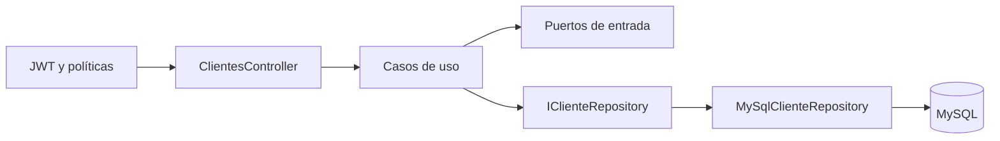

# C4 nivel 3: componentes de Clientes

Archivos principales: `src/PuntoMarket.Clientes.Adapters.In.Api/Controllers/ClientesController.cs`, `src/PuntoMarket.Clientes.Application/UseCases/ClienteUseCases.cs`, `src/PuntoMarket.Clientes.Application/Ports/Out/IClienteRepository.cs` y `src/PuntoMarket.Clientes.Adapters.Out.Persistence/Repositories/MySqlClienteRepository.cs`.
