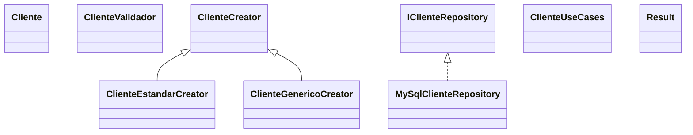

# Diagrama de clases

Patrones: `Result` en `Domain/Common/Result.cs`, Factory Method en `Domain/Creators/ClienteCreator.cs`, Adapter en `Application/Ports/Out/IClienteRepository.cs` y `Adapters.Out.Persistence/Repositories/MySqlClienteRepository.cs`, Singleton para `MySqlDataSource` en `Adapters.Out.Persistence/DependencyInjection.cs`.
